# Albums API

REST-сервіс обліку музичних альбомів на Go з PostgreSQL і вебінтерфейсом на `html/template` та HTMX.
Проєкт виконано в межах курсу «Go with GenAI», варіант `albums`. Тема 7 дала REST API зі сховищем у
пам'яті; Тема 8 перевела його на PostgreSQL через GORM і golang-migrate, нормалізувала схему та виправила
N+1; Тема 9 захистила API: реєстрація і логін з `bcrypt` та JWT, рольова авторизація (`member`, `staff`,
`admin`) у вигляді middleware і AI-асистований аудит безпеки; Тема 10 додає серверний рендеринг:
сторінку каталогу з живим пошуком і видаленням рядків через HTMX, вхід через HttpOnly-cookie, а шаблони,
статику й міграції вбудовує в один бінарник через `go:embed`. Тема 12 (Go Serverless) додає поруч із сервісом
теку [serverless/](serverless/): приклад із презентації (курсовий демо-проєкт на емуляторі AWS Floci у курсовій
VM), власну Lambda-функцію `album.submitted` з HTTP-тригером і згенерований ШІ та перевірений Terraform.

Умова Теми 12, адаптована під варіант `albums`: [albums_lesson12_homework.md](albums_lesson12_homework.md).
Звіт про виконання: розділ [Lesson 12 Report](#lesson-12-report-go-serverless--lambda).

Матеріали Теми 10 і її додаткової частини DevOps Basics (умови, промпти, звіти) лишилися в репозиторії
попередньої теми (<https://github.com/tatarchuk/golang-course-lesson-10>); їхні докази збережено тут у
[docs/web/](docs/web/) і [docs/devops/](docs/devops/). Матеріали Теми 9 (умова, промпти, звіт аудиту) — у
репозиторії <https://github.com/tatarchuk/golang-course-lesson-9>, її докази — у [docs/auth/](docs/auth/).

## Швидкий запуск (Docker Compose)

Потрібен Docker з Compose v2. PostgreSQL 16 і API піднімаються разом; міграції (схема та демо-дані:
3 жанри, 6 виконавців, 10 альбомів, 24 примірники, 3 акаунти з ролями `admin`, `staff` і `member`)
застосовуються автоматично на старті. Демо-акаунти не мають пароля: першого адміністратора створює
команда `bootstrap` (крок 4).

```sh
# 1. Клонувати репозиторій
git clone https://github.com/tatarchuk/golang-course-lesson-10.git && cd golang-course-lesson-10

# 2. Конфігурація: значення збігаються зі стандартними в docker-compose.yml. JWT_SECRET у
#    .env.example - лише заготовка, сервер її відхилить: згенеруйте свій (Linux: sed -i без '')
cp .env.example .env
sed -i '' "s|^JWT_SECRET=.*|JWT_SECRET=$(openssl rand -base64 48)|" .env

# 3. Зібрати образ і запустити PostgreSQL + API (http://localhost:8080)
docker compose up -d --build

# 4. Дати адміністраторові пароль (ADMIN_PASSWORD з .env; те саме з хоста: make bootstrap)
docker compose exec -e ADMIN_PASSWORD=Albums-Dev-2026 api /app/bootstrap -email admin@albums.local

# 5. Перевірити
curl -s localhost:8080/health                      # {"status":"ok"}
curl -s 'localhost:8080/api/v1/albums?limit=2'     # каталог читається без токена
curl -s -X POST localhost:8080/api/v1/auth/login -H 'Content-Type: application/json' \
  -d '{"email":"admin@albums.local","password":"Albums-Dev-2026"}'   # {"token":"<jwt>"}
open http://localhost:8080/catalog                 # вебкаталог із живим пошуком; вхід через /login (адміністратор із кроку 4)
docker compose logs -f api                         # кожен SQL-запит потрапляє в лог (без значень)
docker compose down                                # зупинити; дані лишаються у volume pgdata
```

Те саме через `make up`, `make bootstrap`, `make logs`, `make down` (усі цілі: `make` без аргументів
показує Makefile). Без `JWT_SECRET` стек не стартує: `docker-compose.yml` навмисно не має для нього
типового значення, а сервер відмовляється від секрету, коротшого за 32 байти, і від заготовки
`change-me…` з `.env.example` (`validateSecret` у `cmd/api/main.go`). PostgreSQL опубліковано лише
на `127.0.0.1`.

Образ API більше не містить теки `migrations/`: шаблони, статика й SQL-міграції вбудовані в обидва бінарники,
тож `/app` в образі — це лише `api` і `bootstrap`. Вебінтерфейс після старту: <http://localhost:8080/catalog>
(вхід — <http://localhost:8080/login>, адміністратор із кроку 4).

Скриншоти Теми 10 (headless Chrome проти бінарника, запущеного з порожньої теки): [каталог](docs/screenshots/catalog.png),
[пошук `kid`](docs/screenshots/catalog-search.png), [сторінка входу](docs/screenshots/login.png). Скриншоти Теми 8:
[Swagger UI з виконаним `GET /api/v1/albums`](docs/screenshots/swagger-get-albums-200.jpg) та
[огляд API](docs/screenshots/swagger-overview.jpg). Текстові докази Теми 9: [docs/auth/token-flow.txt](docs/auth/token-flow.txt)
і [docs/auth/smoke.txt](docs/auth/smoke.txt); Теми 10 — у [docs/web/](docs/web/) (тести до і після, ізоляція,
аудит шаблонів, cookie-сценарій, SQL-лог сторінки каталогу, smoke).

### Запуск на хості

Потрібен Go 1.25.11 або новіший (версія з `go.mod`). База береться з compose, сервер запускається
локально і так само застосовує міграції на старті.

```sh
docker compose up -d postgres        # або make db
set -a; . ./.env; set +a             # DATABASE_URL, JWT_SECRET, PORT, COOKIE_SECURE, ADMIN_* (MIGRATIONS_PATH - лише перевизначення)
make bootstrap                       # go run ./cmd/bootstrap -email $ADMIN_EMAIL (пароль з ADMIN_PASSWORD)
go run ./cmd/api                     # або make run
make build                           # bin/api: статично злінкований бінарник (CGO_ENABLED=0) із вбудованими шаблонами, статикою й міграціями
```

| Змінна | Призначення | Типово |
|---|---|---|
| `DATABASE_URL` | рядок підключення PostgreSQL, обов'язкова | — |
| `JWT_SECRET` | секрет підпису JWT (HS256), обов'язкова: щонайменше 32 байти, заготовка `change-me…` з `.env.example` відхиляється (`openssl rand -base64 48`) | — |
| `MIGRATIONS_PATH` | необов'язкове перевизначення: тека з SQL-файлами golang-migrate замість набору, вбудованого в бінарник (`migrations/embed.go`) | — (вбудовані міграції) |
| `COOKIE_SECURE` | прапорець `Secure` на cookie сесії вебінтерфейсу (`albums_token`); `true` за TLS-проксі | `false` |
| `PORT` | порт HTTP-сервера | `8080` |
| `DB_LOG_LEVEL` | логер GORM: `info` (кожен запит), `warn`, `error`, `silent` | `info` |
| `ADMIN_EMAIL`, `ADMIN_PASSWORD` | акаунт, який створює або скидає `make bootstrap` (лише для `cmd/bootstrap`) | `admin@albums.local`, — |

### Тести та перевірки

```sh
docker compose up -d postgres                 # базу albums_test створює scripts/initdb на першому старті
go test ./internal/app/ -run Web -v           # приймальні тести Теми 10 (червоні до реалізації: docs/web/tests-before.txt)
go test ./internal/app/ -run 'Auth|RBAC' -v   # приймальні тести Теми 9
make test                                     # go test ./... -race -count=1 з TEST_DATABASE_URL із .env
go test ./internal/model ./internal/handler ./internal/middleware ./internal/auth   # без бази даних
go test ./internal/handler/web                # тести вебобробників на фейках (31 підтестів), без бази
gofmt -l . && go vet ./...
scripts/smoke.sh http://localhost:8080        # повтор API + веб smoke-тесту CI (100 перевірок) проти запущеного стека (після bootstrap)
```

Тести з базою (`internal/repository`, `internal/app`, `cmd/bootstrap`) читають `TEST_DATABASE_URL`;
без неї вони пропускаються, а в CI змінна задана, тож пропусків немає. `JWT_SECRET` тести задають самі
(`t.Setenv` перед побудовою роутера), тому для `make test` він у `.env` не потрібен. Пакети, що
працюють із базою, серіалізуються advisory-lock'ом (`internal/testdb`), кожен тест починає з порожніх
таблиць (включно з `users`, тому seed-акаунти в тестах відсутні).

- `internal/model`: валідація вхідних структур, `null` для необов'язкових полів, хибні JSON-типи;
  `RegisterInput`, `LoginInput`, `RoleInput`, `NormalizeEmail`, `TestUserJSONHidesPasswordHash`.
- `internal/auth`: хешування та перевірка пароля, видача токена, відхилення токена без `exp`,
  простроченого, з іншим секретом, зі зміненим payload, з `alg: none`, з `user_id` 0; користувач у контексті.
- `internal/repository`: інтеграційні тести з реальною БД: створення зі зв'язками, невідомі посилання
  (`invalid_reference`), дублікати (`conflict`), список із фільтром і пагінацією, повна заміна у `PUT`,
  каскад при видаленні, примірники та доступність, ідемпотентність міграцій, guard-тест
  `TestListQueryCountIsConstant` на N+1, `UserRepository`, `TestMigrationAddsPasswordHashColumn`,
  `TestMigrateFSAppliesTheEmbeddedSet` (вбудований набір: 3 пари up/down, повторний запуск — no-op, версія 3);
  `TestOpenLogsSQLWithoutValues` тепер покриває і `Scan`-запит наявності (значення не потрапляють у лог).
  Тема 10: пошук за назвою або виконавцем без урахування регістру (`ListOptions.Query`: `ILIKE`,
  екранування `%`, `_` і `\`, поєднання з фільтром за жанром і пагінацією, та сама кількість `SELECT`,
  що й без пошуку) і `AvailabilityForAlbums` одним запитом для цілої сторінки (альбоми без примірників
  відсутні в результаті, порожній список id не торкається бази).
- `internal/handler`: обробники з фейковими репозиторіями: порядок перевірок, коди помилок, парсинг;
  реєстрація, логін (однакове тіло `401` для всіх невдач, одне bcrypt-порівняння завжди), `GET /me`,
  список акаунтів і зміна ролі; Тема 10: `Authenticate` (нормалізація e-mail, та сама помилка для невідомого
  e-mail, хибного пароля й акаунта без пароля; помилка сховища не маскується).
- `internal/handler/web` (`catalog_test.go`, фейки у `fakes_test.go`, маршрутизація як в `app.go`): сторінка
  каталогу для анонімного, `member`, `staff`, `admin` і видаленого акаунта (екранування назви, `?q=` доходить
  до репозиторію як `Query` і повертається у поле), фрагмент рядків (лише `<tr>`, порожній рядок, кнопка для
  `staff`, `303` без `HX-Request`), матриця на `DELETE /web/albums/{id}` (`401`/`403`/`200`/`404`/`400`,
  Bearer-заголовок ігнорується, крос-сайт `403`, перевіряється, що саме дійшло до репозиторію), логін і логаут
  (атрибути cookie й claims токена, `Secure` за `COOKIE_SECURE`, однакові тіла двох невдач без `Set-Cookie`, `400`
  для нечитабельної форми та для тіла понад 16 КіБ), порожній рядок на 6 або 7 колонок.
- `internal/middleware`: паніка → 500, CORS (з `Authorization`), логування, `Auth` (сім видів хибних
  облікових даних → `401`), `RequireRole` (`401`/`403`).
  Тема 10: `CookieAuth` (валідна cookie кладе claims у контекст; відсутня, прострочена, з іншим секретом
  чи під іншим ім'ям — анонімний запит без відповіді-помилки; заголовок `Authorization` ігнорується) і
  пара `CookieAuth` + `RequireRole` (`401`/`403`/прохід із кодами API); `SecurityHeaders` (CSP, `nosniff`, `DENY`,
  `Referrer-Policy`).
- `internal/app`: e2e через `NewRouter()` і реальну БД: сценарій smoke-тесту CI, граничні випадки
  контракту Теми 7, приймальні тести Теми 9 (`auth_test.go`, `rbac_test.go`) і Теми 10 (`web_test.go`:
  `TestWebCatalogPage`, `TestWebAlbumRowsFragment`, `TestWebDeleteRow`, `TestWebLoginAndLogout`,
  `TestWebStaticAssets`, `TestWebSecurityHeadersAndRootFallback`; таблиця в розділі [Частина 3 звіту Теми 10](https://github.com/tatarchuk/golang-course-lesson-10#частина-3-goembed-і-тести));
  `TestNewRouterPanicsWithoutSecret` фіксує fail fast без секрету.
- `web`: шаблони розбираються з вбудованої файлової системи так само, як в обробниках (макет і партіали
  один раз, клон на сторінку); сторінка каталогу рендерить рядки, наявність `2/3`, кнопки видалення лише
  для `CanDelete` і екранує HTML у назві та лапки в `q`; партіал рядків — лише `<tr>`; сторінка входу не
  повертає введений e-mail; статика містить `app.css` і `htmx.min.js`, а префікс `static/` знято.
- `cmd/bootstrap`: команда створює адміністратора, повторний запуск скидає пароль того самого рядка;
  без пароля або `DATABASE_URL` завершується помилкою; мігрує вбудованим набором, як і API.

CI ([.github/workflows/theme8-check.yml](.github/workflows/theme8-check.yml), тепер «Theme 8 + Theme 9 +
Theme 10 + Theme 12 check») перевіряє структуру файлів, статичні правила, міграції на PostgreSQL, тести з реальною БД і
smoke-тест API та вебінтерфейсу. Додано для Теми 10. У статичній джобі: обов'язкові файли `web/`,
`migrations/embed.go`, вебобробники з їхніми тестами; лише `html/template` і жодного з типів
`template.HTML`, `HTMLAttr`, `JS`, `JSStr`, `URL`, `CSS`, `Srcset`; `go:embed` і `fs.Sub` у `web/`, `ParseFS` без `ParseGlob`; вбудовані міграції без `COPY
migrations` у `Dockerfile`; прапорці cookie (`HttpOnly`, `SameSite=Lax`), `CrossOriginProtection` в `app.go`,
`CookieAuth` без `Authorization` і `Auth` без cookie; контрольна сума htmx 2.0.11; `COOKIE_SECURE` у
`.env.example` і `docker-compose.yml`; `make build`. В інтеграційній
джобі: статична збірка `CGO_ENABLED=0` з перевіркою `file ... statically linked`, запуск бінарника самого з
порожньої теки без `MIGRATIONS_PATH` (у лозі має бути `applying the embedded set`) і веб smoke-тест: сторінка
каталогу й статика, фрагмент за `HX-Request` і `303` без нього, cookie-вхід адміністратора з `#HttpOnly_` у
cookie jar, матриця видалення (анонім `401`, member `403`, Bearer `401`, крос-сайт `403`, адміністратор —
порожній `200`, альбом зникає з API і з фрагмента), логаут прострочує cookie, сторінки несуть `Content-Security-Policy`,
`X-Frame-Options` і `nosniff`, статика кешується, анонімний `GET /catalog` коштує не більше 5 `SELECT`, у лозі
сервера немає токенів. Локальний повтор: `scripts/smoke.sh` дає 102/102
([docs/web/smoke.txt](docs/web/smoke.txt)). Додано для Теми 12: джоба `serverless` — матриця з двох Go-модулів
(`serverless/libratrack-lambda-demo` і `serverless/albums-lambda`) з `go vet`, `go test -race` і `bash -n` для
скриптів; обов'язкові файли serverless-частини; `prompts.txt` знову під JWT-guard; перевірка «лише ASCII у `.go`»
пропускає теку демо (курсовий код з українськими коментарями). Workflow запускається на кожен push і pull request;
зелений запуск коду Теми 10: <https://github.com/tatarchuk/golang-course-lesson-10/actions/runs/38913600126>, Теми 12 —
у розділі [Lesson 12 Report](#lesson-12-report-go-serverless--lambda).

### Документація API

- Swagger UI із запуском запитів з браузера: <http://localhost:8080/swagger/index.html>; для захищених
  маршрутів кнопка **Authorize** приймає рядок `Bearer <token>` (схема `BearerAuth`), після чого Swagger
  додає заголовок `Authorization` до запитів.
- Специфікація OpenAPI: [docs/swagger.yaml](docs/swagger.yaml), [docs/swagger.json](docs/swagger.json).
- Runbook із `curl`-запитами на всі випадки контракту, включно з отриманням токена та випадками
  `401`/`403`, і розділом 8 про вебінтерфейс (cookie jar, `HX-Request`, видалення рядка, логаут): [docs/CURL.md](docs/CURL.md).

Специфікацію згенеровано утилітою [swag](https://github.com/swaggo/swag) з анотацій у `cmd/api/main.go`
та обробниках `internal/handler/*_handler.go`; після їх зміни: `make swagger`. Усі анотації лишаються
ASCII, бо CI перевіряє і згенерований `docs/docs.go`. Вебобробники анотацій не мають: вони не є частиною
API `/api/v1`.

## Вебінтерфейс (Тема 10)

Сторінки рендеряться на сервері з шаблонів `html/template` (`web/templates/`), інтерактивність дає
HTMX (`web/static/htmx.min.js`, зафіксована версія 2.x) без власного JavaScript. Каталог публічний, як і
`GET /api/v1/albums`; кнопки видалення бачать лише `staff` та `admin` після входу через `/login`.

| Запит | Доступ | Відповідь |
|---|---|---|
| `GET /catalog?q=` | публічний | `200` HTML: макет, форма пошуку (`name="q"`), таблиця альбомів (назва, виконавці, жанр, рік, лейбл, примірники `доступно/усього`); `q` фільтрує на сервері за назвою або виконавцем без урахування регістру і повертається в поле; показує перші 50 збігів за `id`, пагінації в UI немає |
| `GET /web/albums?q=` | публічний | із заголовком `HX-Request: true` → `200` лише рядки `<tr>` (порожній результат → один `<tr class="empty">`); без заголовка → `303` на `/catalog?q=` |
| `DELETE /web/albums/{id}` | `staff`, `admin` (лише cookie) | `200` з порожнім тілом, альбом і примірники видалено; анонімний → `401`, `member` → `403`, заголовок `Authorization` ігнорується (`401`), невідомий id → `404`, нечисловий → `400`; крос-сайтовий запит → `403` |
| `GET /login` | публічний | `200` форма входу |
| `POST /login` | публічний | form-encoded `email`, `password`; успіх → `303` на `/catalog` і cookie `albums_token`; невідомий e-mail і хибний пароль → однаковий `401` з формою і текстом `invalid credentials` |
| `POST /logout` | будь-хто | `303` на `/catalog`, cookie прострочена |
| `GET /static/app.css`, `GET /static/htmx.min.js` | публічний | `200` із вбудованої файлової системи; невідомий файл → `404`, лістинг теки не віддається |

HTMX-атрибути з умови: поле пошуку `hx-get="/web/albums" hx-trigger="keyup changed delay:300ms"
hx-target="#album-list"`; кнопка видалення `hx-delete="/web/albums/{id}" hx-target="closest tr"
hx-swap="outerHTML" hx-confirm="Delete this album?"`. Обробник видалення відповідає порожнім `200`, а не
`204`: HTMX не виконує swap на `204`, тоді як порожній `200` із `outerHTML` прибирає рядок.

Cookie сесії `albums_token` містить той самий HS256 JWT, що й API, з атрибутами `Path=/`, `Max-Age=86400`,
`HttpOnly`, `SameSite=Lax` і `Secure`, коли `COOKIE_SECURE=true`. API її не приймає (лише
`Authorization: Bearer`), а вебмаршрути не приймають заголовок: дві поверхні аутентифікації не
перетинаються. Крос-сайтовий запит на будь-який вебмаршрут зі зміною стану відхиляє
`http.CrossOriginProtection` (перевірка `Sec-Fetch-Site`/`Origin`, Go 1.25) з тим самим конвертом `403`
`forbidden`. Докладніше в розділі [Частина 1 звіту Теми 10](https://github.com/tatarchuk/golang-course-lesson-10#частина-1-архітектура-вебшару-та-аудит-автоекранування).

Відомі обмеження: токен без стану діє до `exp` і після логауту чи видалення акаунта (сторінка й фрагмент показують
такий акаунт як анонімний, але `DELETE /web/albums/{id}` довіряє ролі з токена, як і staff-маршрути API); на
`401`/`403`/`404` із маршруту видалення HTMX не виконує swap, тож рядок лишається без повідомлення (стан видно після
перезавантаження сторінки); обмеження частоти входу немає ні для форми, ні для `POST /api/v1/auth/login`
(відстежено з Теми 9).

## API

Усі відповіді, крім `204`, мають `Content-Type: application/json`; ключі в `snake_case`.
Необов'язкові поля завжди присутні у відповіді (`null`, якщо не задані); час у RFC 3339 (UTC, `Z`).
Захищені маршрути приймають заголовок `Authorization: Bearer <token>`; перевірка доступу виконується
до перевірок запиту: без токена або з хибним токеном → `401` `unauthenticated`, з недозволеною
роллю → `403` `forbidden`, і відхилений запит нічого не змінює.

### Ролі та доступ

Ролі ті, що є в схемі (`CHECK (role IN ('member','staff','admin'))` у
[migrations/000001_init_schema.up.sql](migrations/000001_init_schema.up.sql)):

| Роль | Хто це | Що може |
|---|---|---|
| `member` | типова роль нового акаунта | читати каталог, бачити свій акаунт (`GET /me`), користуватися вебкаталогом |
| `staff` | персонал каталогу | усе, що `member`, плюс створення, зміна й видалення жанрів, виконавців, альбомів і примірників, зокрема видалення рядків у вебкаталозі |
| `admin` | адміністратор | усе, що `staff`, плюс список акаунтів і зміна ролей |

Матриця доступу API (статус для кожної ролі; anonymous = без токена; її перевіряє `TestRBACMatrix`):

| Маршрут | anonymous | member | staff | admin |
|---|---|---|---|---|
| `GET /api/v1/albums`, `GET /api/v1/genres` та інші `GET` каталогу | 200 | 200 | 200 | 200 |
| `GET /api/v1/me` | 401 | 200 | 200 | 200 |
| `POST /api/v1/genres`, `POST /api/v1/artists`, `POST /api/v1/albums`, `POST /api/v1/albums/{id}/copies` | 401 | 403 | 201 | 201 |
| `PUT /api/v1/albums/{id}` | 401 | 403 | 200 | 200 |
| `DELETE /api/v1/albums/{id}` | 401 | 403 | 204 | 204 |
| `GET /api/v1/users`, `PUT /api/v1/users/{id}/role` | 401 | 403 | 403 | 200 |
| `DELETE /web/albums/{id}` (cookie) | 401 | 403 | 200 | 200 |

### Ресурси

```json
{
  "id": 1,
  "title": "Kind of Blue",
  "label": "Columbia",
  "genre_id": 1,
  "genre": {"id": 1, "name": "jazz", "created_at": "2026-10-09T10:00:00Z", "updated_at": "2026-10-09T10:00:00Z"},
  "artists": [
    {"id": 1, "name": "Miles Davis", "bio": "Trumpeter and bandleader.", "created_at": "...", "updated_at": "..."},
    {"id": 2, "name": "John Coltrane", "bio": null, "created_at": "...", "updated_at": "..."}
  ],
  "release_year": 1959,
  "notes": null,
  "created_at": "2026-10-09T10:00:00Z",
  "updated_at": "2026-10-09T10:00:00Z"
}
```

Тіло `POST`/`PUT /albums` посилається на жанр і виконавців за `id`:

| Поле | Тип | Обов'язкове | Примітка |
|---|---|---|---|
| `title`, `label` | рядок | так | не порожні й не лише з пробілів; пара `title` + `label` унікальна |
| `genre_id` | ціле | так | має існувати, інакше `422` `invalid_reference` |
| `artist_ids` | масив цілих | так | непорожній, без повторів; невідомий id → `422` `invalid_reference` |
| `release_year` | ціле | ні | від 0 до 9999; `null`, якщо не задано |
| `notes` | рядок | ні | `null`, якщо не задано |

Інші ресурси каталогу: жанр `{"id","name",...}` (вхід `{"name"}`, ім'я унікальне), виконавець
`{"id","name","bio",...}` (вхід `{"name","bio"}`), примірник `{"id","album_id","inventory_no","status",...}`
(вхід `{"inventory_no","status"}`, статус `available` | `borrowed` | `lost`, типово `available`,
`inventory_no` унікальний), доступність `{"album_id","total_copies","available_copies"}`.

Акаунт: `{"id","email","role","created_at","updated_at"}`; хеш пароля не потрапляє в жодну відповідь
(`PasswordHash` має тег `json:"-"`). Токен: `{"token":"<jwt>"}`, HS256 із секретом `JWT_SECRET`,
claims `user_id`, `role`, `exp` (24 години) та `iat`. Вхідні структури навмисно вузькі, щоб mass
assignment був неможливий:

| Запит | Тіло | Примітка |
|---|---|---|
| `POST /auth/register`, `POST /auth/login` | `{"email","password"}` | обидва обов'язкові й не порожні; e-mail нормалізується (пробіли, регістр), має вигляд `name@domain` і не довший за 254 байти; пароль при реєстрації 8..72 байти; поля `role` у вході немає: новий акаунт завжди `member` |
| `PUT /users/{id}/role` | `{"role"}` | `member` \| `staff` \| `admin`, інакше `422` `validation_error` |

### Ендпоінти

| Запит | Доступ | Відповідь |
|---|---|---|
| `GET /health` | публічний | `200` `{"status":"ok"}` |
| `POST /api/v1/auth/register` | публічний | `201` акаунт із `role: "member"`; порожні або відсутні `email`/`password`, e-mail не у формі `name@domain`, закороткий пароль, тіло не JSON → `422` `validation_error`; зайнятий e-mail → `422` `validation_error` з повідомленням `email already registered` |
| `POST /api/v1/auth/login` | публічний | `200` `{"token":"<jwt>"}`; невідомий e-mail, хибний пароль і акаунт без пароля → той самий `401` `unauthenticated` `invalid credentials`; відсутній пароль → `422` |
| `GET /api/v1/me` | будь-який аутентифікований | `200` акаунт власника токена; без токена або якщо акаунт видалено → `401` |
| `POST /api/v1/genres` | `staff`, `admin` | `201`; дубль імені → `409` `conflict`; порожнє ім'я → `422` |
| `GET /api/v1/genres`, `GET /api/v1/genres/{id}` | публічний | `200`; невідомий id → `404` |
| `POST /api/v1/artists` | `staff`, `admin` | `201`; порожнє ім'я → `422` |
| `GET /api/v1/artists`, `GET /api/v1/artists/{id}` | публічний | `200`; невідомий id → `404` |
| `POST /api/v1/albums` | `staff`, `admin` | `201` з вкладеними `genre` та `artists`; дубль `title`+`label` → `409`; невідомі посилання → `422` `invalid_reference`; інша валідація → `422` `validation_error` |
| `GET /api/v1/albums?page=&limit=&genre_id=` | публічний | `200` масив (порожній як `[]`); `400` `invalid_pagination` або `validation_error` |
| `GET /api/v1/albums/{id}` | публічний | `200`; `400` `invalid_id`; `404` `not_found` |
| `PUT /api/v1/albums/{id}` | `staff`, `admin` | `200`, повна заміна, виконавці замінюються списком; `400`, `422`, `404` |
| `DELETE /api/v1/albums/{id}` | `staff`, `admin` | `204` без тіла; каскадом зникають примірники та зв'язки; `400`, `404` |
| `POST /api/v1/albums/{id}/copies` | `staff`, `admin` | `201` (`status` типово `available`); дубль `inventory_no` → `409`; хибний статус → `422`; невідомий альбом → `404` |
| `GET /api/v1/albums/{id}/copies`, `GET /api/v1/albums/{id}/availability` | публічний | `200`; невідомий альбом → `404` |
| `GET /api/v1/users` | `admin` | `200` масив акаунтів без хешів |
| `PUT /api/v1/users/{id}/role` | `admin` | `200` оновлений акаунт; роль поза списком або відсутня → `422` `validation_error`; невідомий id → `404`; нечисловий id → `400` `invalid_id` |
| `GET /swagger/` | публічний | Swagger UI |

- **Список:** порядок за `id`; `page` і `limit` типово 1 і 10, мають бути цілими `>= 1`, `limit` понад
  100 обрізається до 100; `genre_id` — точний збіг, порожнє значення означає «без фільтра».
- **`PUT` — повна заміна:** необов'язкові поля, яких немає в тілі, стають `null`; `artist_ids` замінюють
  попередній список. Порядок перевірок: доступ (401/403) → `id` (400) → тіло (422) → існування (404) →
  посилання (422); відхилений запит нічого не змінює (транзакція).
- **`{id}`** — ціле від 0 до 4294967295 (`uint32`), інакше `400` `invalid_id`.
- **Помилки** мають єдиний формат `{"error":{"code":"…","message":"…"}}` без внутрішніх деталей. Коди:
  `invalid_id`, `invalid_pagination`, `validation_error`, `invalid_reference`, `conflict`, `not_found`,
  `unauthenticated`, `forbidden`, `internal_server_error`. Невідомий маршрут і непідтримуваний метод
  дають JSON `404` (зокрема `GET /`: домашньої сторінки немає, вхід у вебінтерфейс — `/catalog`).
- **Токен без стану:** зміна ролі через `PUT /users/{id}/role` діє з наступного логіну; виданий раніше
  токен зберігає стару роль до `exp`.
- **CORS:** кожна відповідь має `Access-Control-Allow-Origin: *`; `OPTIONS` → `204` зі списком методів
  і заголовків `Content-Type, Authorization`; preflight обробляється до перевірки токена. Облікові дані
  (cookie) у крос-доменних запитах браузери не надсилають, бо `Access-Control-Allow-Credentials` не задано.

### Як отримати токен

Повний запис цього сценарію з реальними відповідями (Тема 9): [docs/auth/token-flow.txt](docs/auth/token-flow.txt).

```sh
BASE=localhost:8080/api/v1

# Реєстрація: новий акаунт завжди member (ids у вас можуть відрізнятися)
curl -s -X POST $BASE/auth/register -H 'Content-Type: application/json' \
  -d '{"email":"alice@example.com","password":"Correct-Horse-Battery-1"}'
# 201 {"id":4,"email":"alice@example.com","role":"member","created_at":"...","updated_at":"..."}

# Логін: токен на 24 години
TOKEN=$(curl -s -X POST $BASE/auth/login -H 'Content-Type: application/json' \
  -d '{"email":"alice@example.com","password":"Correct-Horse-Battery-1"}' | jq -r .token)

# Захищений маршрут
curl -s $BASE/me -H "Authorization: Bearer $TOKEN"
# 200 {"id":4,"email":"alice@example.com","role":"member",...}

# member не може писати в каталог (403 forbidden); без токена взагалі 401 unauthenticated
curl -s -X POST $BASE/genres -H "Authorization: Bearer $TOKEN" -H 'Content-Type: application/json' -d '{"name":"ambient"}'
# 403 {"error":{"code":"forbidden","message":"this action requires role staff or admin"}}

# staff або admin: 201 (адміністратор з розділу «Стартовий адміністратор»)
ADMIN=$(curl -s -X POST $BASE/auth/login -H 'Content-Type: application/json' \
  -d '{"email":"admin@albums.local","password":"Albums-Dev-2026"}' | jq -r .token)
curl -s -X POST $BASE/genres -H "Authorization: Bearer $ADMIN" -H 'Content-Type: application/json' -d '{"name":"ambient"}'
# 201 {"id":4,"name":"ambient",...}

# Адміністратор підвищує alice до staff: новий логін alice видає токен із новою роллю,
# старий токен лишається member до exp
curl -s -X PUT $BASE/users/4/role -H "Authorization: Bearer $ADMIN" -H 'Content-Type: application/json' -d '{"role":"staff"}'
# 200 {"id":4,"email":"alice@example.com","role":"staff",...}
```

### Стартовий адміністратор

Міграції не зберігають хешів. Міграція [000003_add_auth_fields](migrations/000003_add_auth_fields.up.sql)
додає колонку `password_hash TEXT NOT NULL DEFAULT ''`; seed-акаунти `admin@albums.local`,
`staff@albums.local` і `member@albums.local` лишаються без пароля і не можуть увійти (порожній хеш ніколи
не збігається, а логін порівнює його з фіктивним хешем, щоб і час відповіді нічого не видавав). Першого
адміністратора створює або скидає команда [cmd/bootstrap](cmd/bootstrap/main.go): вона перевіряє вхід
тими самими правилами, що й реєстрація, застосовує міграції (якщо API ще не застосував), хешує пароль
bcrypt і робить upsert рядка з роллю `admin`. Повторний запуск скидає пароль того самого рядка.

```sh
make bootstrap                                   # на хості: ADMIN_EMAIL і ADMIN_PASSWORD з .env
docker compose exec -e ADMIN_PASSWORD=Albums-Dev-2026 api /app/bootstrap -email admin@albums.local   # у контейнері
```

Dev-пароль `Albums-Dev-2026` задокументовано тут і в `.env.example`; для будь-якого іншого середовища
його треба змінити (`.env` не комітиться). Тим самим акаунтом можна увійти і у вебінтерфейс (`/login`).

| Акаунт | Роль | Пароль |
|---|---|---|
| `admin@albums.local` | `admin` | після `make bootstrap`: `Albums-Dev-2026` (або інший з `ADMIN_PASSWORD`) |
| `staff@albums.local` | `staff` | немає, увійти не може; за потреби `cmd/bootstrap -email staff@albums.local` (стане `admin`) або реєстрація нового акаунта і `PUT /users/{id}/role` |
| `member@albums.local` | `member` | немає, увійти не може |

## Структура проєкту та прийняті рішення

```
cmd/api/main.go                      конфігурація з env (JWT_SECRET читається один раз, порожній -> fail fast), вбудовані міграції або MIGRATIONS_PATH, app.Config з Templates/Static/CookieSecure, HTTP-сервер, graceful shutdown
cmd/bootstrap/main.go                створення або скидання адміністратора: bcrypt-хеш + upsert з роллю admin
internal/app/app.go                  NewRouter(repos, cfg): групи public / protected / staff / admin + вебгрупа (cookie, CrossOriginProtection, /static/) -> ServeMux -> Logging(Recover(CORS))
internal/auth/                       bcrypt-хешування (DummyHash для невідомих акаунтів), видача та перевірка HS256 JWT, користувач у контексті запиту
internal/model/                      GORM-моделі Album, Artist, Genre, Copy, User (PasswordHash json:"-"), AlbumArtist + вхідні структури з Validate()
internal/repository/                 інтерфейси та GORM-реалізації, errors.go, db.go (Open), migrate.go (MigrateFS для вбудованого набору, Migrate для теки)
internal/handler/                    HTTP-обробники API (*_handler.go), authenticate.go (спільна перевірка облікових даних), errors.go, парсинг (+ PathID, WriteRepoError для вебшару)
internal/handler/web/                вебінтерфейс: Catalog, Rows (фрагмент для HX-Request), Delete (порожній 200), LoginForm/Login/Logout (cookie albums_token), StaticFiles; шаблони розбираються раз, клон на сторінку
internal/middleware/                 Logging, Recover, CORS (+ Authorization), Auth, RequireRole, CookieAuth (сесія вебінтерфейсу)
internal/testdb/                     спільне підключення для тестів із БД (advisory lock, вбудовані міграції, TRUNCATE)
migrations/                          000001_init_schema, 000002_seed_demo_data, 000003_add_auth_fields (up/down) + embed.go: SQL-файли вбудовані в бінарник
web/                                 вбудовані файли вебінтерфейсу (go:embed): templates.go, static.go, templates/ (layout, catalog, login, partials/album_row*), static/ (app.css, htmx.min.js 2.0.11)
docs/                                OpenAPI (swag, BearerAuth), runbook з curl, ER-діаграма, docs/n1/ (Тема 8), docs/auth/ (Тема 9), docs/web/ (Тема 10), docs/devops/ (додаткова частина Теми 10), docs/serverless/ і docs/screenshots/serverless/ (Тема 12)
scripts/                             initdb/ (бази для тестів), smoke.sh (smoke-тест CI: API з логіном + вебінтерфейс із cookie jar), measure_n1.sh (N+1), render_er.sh
Dockerfile, docker-compose.yml       образ API з обома бінарниками (/app/api, /app/bootstrap) без теки migrations/ і стек postgres + api (JWT_SECRET обов'язковий, COOKIE_SECURE)
Makefile, .env.example               щоденні команди (+ bootstrap, build) та приклад конфігурації (COOKIE_SECURE; MIGRATIONS_PATH закоментовано)
Vagrantfile                          VM для додаткової частини: Ubuntu 24.04 arm64 (VirtualBox), порти на 127.0.0.1, репозиторій у /app, провізіонери docker-engine, floci, aws-tools, k3s
deploy/vagrant/                      провізіонери (Docker Engine, AWS CLI + awslocal, k3s), env-status.sh, обхід перевірки портів Vagrant на macOS 27 (port_check_fix.rb + тест)
deploy/floci/                        Floci (compose.floci.yaml), Demo 1 (demo1-ec2.sh), Demo 2 (demo2-lambda.sh; lambda/ — окремий Go-модуль із тестами)
deploy/k8s/                          k3s: PostgreSQL (StatefulSet), API (Deployment, NodePort), Ingress (Traefik), bootstrap Job, create-secrets.sh
serverless/Vagrantfile               курсова VM Теми 12 (DockerGoGroup: Docker, Go, Terraform, AWS CLI, SAM CLI) з виправленнями для Apple Silicon і портами 4566/4500
serverless/libratrack-lambda-demo/   курсовий демо-проєкт, приклад із презентації (webhook і thumbnail, SAM, Floci, Terraform, бенчмарк), із задокументованими виправленнями
serverless/albums-lambda/            власна Lambda album.submitted: cmd/webhook (+ тести), events/, template.yaml (SAM), terraform/ (згенеровано ШІ, перевірено), scripts/
albums_lesson12_homework.md          умова Теми 12, адаптована під варіант albums, UA + EN
prompts.txt                          промпт генерації Terraform (дослівно, з перекладом) і промпт фінального рев'ю
.github/workflows/theme8-check.yml   CI «Theme 8 + 9 + 10 + 12»: структура й статичні правила (html/template, go:embed, cookie), міграції, тести, статичний бінарник з порожньої теки, API + веб smoke-тест, vet і тести обох Lambda-модулів
```


Рішення Теми 8, які лишаються в силі:

- **Шари.** Обробники залежать лише від інтерфейсів репозиторіїв; `NewRouter` отримує їх структурою
  `repository.Repositories`, тож тести обробників працюють на фейках, а `main` передає GORM-реалізації.
- **Запис альбому** виконується в транзакції: спочатку перевіряються жанр і виконавці (невідомий id →
  `ErrInvalidReference`), потім вставляється рядок `albums` з `Omit(clause.Associations)`, а рядки
  `album_artists` пишуться явно. `PUT` оновлює колонки через `Select(...)`, тому `nil`-вказівники
  пишуться як `NULL`, а зв'язки перезаписуються в тій самій транзакції.
- **Помилки драйвера** перекладаються один раз (`TranslateError: true` → `translate()` →
  `ErrConflict`, `ErrInvalidReference`, `ErrInvalidInput`), обробники мапують їх на 409/422.
- **Схема лише через міграції:** `AutoMigrate` не використовується; `Migrate()` запускає golang-migrate
  як бібліотеку (джерело `iofs`, драйвер `pgx/v5`) на старті застосунку. Каскади оголошені в БД;
  жанри й виконавці захищені `ON DELETE RESTRICT`.
- **N+1:** `List` довантажує зв'язки через `Preload`, 4 `SELECT` незалежно від кількості альбомів;
  логер GORM на рівні `info` пише кожен SQL-запит у stdout з плейсхолдерами (`ParameterizedQueries`).

Рішення Теми 9, які лишаються в силі:

- **Секрет JWT.** `cmd/api/main.go` читає `JWT_SECRET` один раз на старті й завершується з помилкою,
  якщо він порожній, коротший за 32 байти або є заготовкою з `.env.example` (`validateSecret`); роутер
  отримує його явно через `app.Config{JWTSecret}` і панікує на порожнє значення. Тести задають секрет
  через `t.Setenv` і будують роутер після цього.
- **Паролі.** `bcrypt.GenerateFromPassword` з `bcrypt.DefaultCost` (10). Логін виконує
  `bcrypt.CompareHashAndPassword` завжди: для невідомого e-mail і для акаунта з порожнім хешем — проти
  `auth.DummyHash`, тож час відповіді нічого не видає, а тіло `401` в усіх випадках побайтово однакове.
- **Токен.** Лише HS256 (`jwt.WithValidMethods`): інший `alg`, хибний підпис, змінений payload,
  прострочений або відсутній `exp`, `user_id <= 0` чи порожня роль → `401`. Claims `user_id`, `role`,
  `exp` = 24 години, `iat`. Токен без стану: роль береться з claim.
- **Ланцюжок middleware.** Групи маршрутів у `net/http` — хелпери `protected`, `staff`, `admin` в
  `app.go`; `Auth` завжди перед `RequireRole`; невдача пише відповідь через `handler.WriteError` і робить
  `return` без `next.ServeHTTP`.
- **DTO.** `RegisterInput` і `LoginInput` містять лише `email` та `password`, `RoleInput` — лише `role`;
  обробники ніколи не декодують запити в `model.User`; `User.PasswordHash` має тег `json:"-"`.
- **Стартовий адміністратор:** міграція не зберігає хешів; перший пароль задає `cmd/bootstrap`.

Рішення Теми 10:

- **Дві поверхні аутентифікації.** API приймає лише `Authorization: Bearer` (`internal/middleware/auth.go:14`);
  вебмаршрути — лише cookie `albums_token` (`internal/middleware/cookie.go:16`; маршрути в
  `internal/app/app.go:92-106`). Cookie без заголовка не дає доступу до API, заголовок без cookie — до
  вебмаршрутів (`TestWebDeleteRow`: Bearer → `401`), тож CSRF-поверхня обмежена вебмаршрутами, які захищені
  `SameSite=Lax` (`internal/handler/web/auth.go:64-74`) і `http.CrossOriginProtection` (`app.go:96-99`, відповідь —
  конверт `403 forbidden`).
- **Анонімний запит замість помилки.** `CookieAuth` ніколи не відхиляє запит: відсутня чи хибна cookie означає
  анонімного відвідувача (публічний каталог рендериться без кнопок), а `401`/`403` дає наявний `RequireRole` на
  маршруті видалення — ті самі коди й конверт помилок, що й в API (`app.go:93-95`, `TestCookieAuthWithRequireRole`).
  Сторінка й фрагмент показують cookie видаленого акаунта як анонімного відвідувача, але маршрут видалення довіряє
  ролі з токена до `exp`, як і staff-маршрути API (stateless JWT, див. «Відомі обмеження» вище).
- **Порожній `200` замість `204`** на `DELETE /web/albums/{id}` (`internal/handler/web/catalog.go:63-73`): HTMX не
  виконує swap на `204`, а порожній `200` з `hx-swap="outerHTML"` прибирає рядок. API-маршрут
  `DELETE /api/v1/albums/{id}` і далі відповідає `204`.
- **Пошук і наявність без N+1.** `ListOptions.Query` додає `ILIKE ... ESCAPE '\'` за назвою й виконавцем до того
  самого запиту з `Preload` (`internal/repository/album_repository.go:92-97`, екранування в `likePattern`, `:239`);
  наявність примірників для всієї сторінки читається одним `GROUP BY` (`internal/repository/copy_repository.go:72`,
  виклик в `internal/handler/web/view.go:76-85`), тож `GET /catalog` коштує 5 `SELECT` для анонімного відвідувача
  (+1 `users.Get` для залогіненого) незалежно від кількості альбомів ([docs/web/queries-catalog.txt](docs/web/queries-catalog.txt)).
- **Один набір шаблонів на сторінку.** `layout.html` + партіали розбираються один раз, кожна сторінка — клон із
  власним `content` (`internal/handler/web/templates.go:28-44`); відповідь спершу рендериться в буфер
  (`templates.go:58-67`), тож помилка шаблону дає `500`, а не пів сторінки. Лише `html/template`, без
  `template.HTML` ([docs/web/template-audit.txt](docs/web/template-audit.txt)).
- **Усе в бінарнику.** Шаблони, статика (включно з HTMX) і міграції вбудовані через `go:embed` (`web/templates.go:8`,
  `web/static.go:8`, `migrations/embed.go:11`); `MIGRATIONS_PATH` — лише перевизначення для розробки
  (`cmd/api/main.go:121`, `internal/repository/migrate.go:22,46`); образ Docker більше не копіює `migrations/`;
  статика роздається через `StaticFiles` без лістингу тек (`internal/handler/web/static.go:16`).
- **Заголовки для браузера.** Сторінки йдуть із `Content-Security-Policy: default-src 'self'; frame-ancestors 'none';
  base-uri 'self'; form-action 'self'`, `X-Frame-Options: DENY`, `X-Content-Type-Options: nosniff` і
  `Referrer-Policy: same-origin` (`internal/middleware/security.go`), а HTMX не вставляє власний `<style>`
  (`includeIndicatorStyles: false` у `layout.html`), тож політика тримається без `'unsafe-inline'`; статика
  кешується на добу з `nosniff` (`Cache-Control: public, max-age=86400`: у вбудованих файлів немає mtime для
  валідаторів); тіло форми входу обмежене 16 КіБ (`internal/handler/web/auth.go:13,30`). Усе це додано за
  підсумками [фінального рев'ю Теми 10](https://github.com/tatarchuk/golang-course-lesson-10#фінальне-ревю).

## Lesson 12 Report: Go Serverless — Lambda

Умова: [albums_lesson12_homework.md](albums_lesson12_homework.md) — оцінювання «[Tasks 12] Go Serverless», слайд 48
презентації «Go Serverless: Lambda-функції на стероїдах» і шаблон домашнього завдання курсового демо. Презентація й
демо називають тему «Урок 11»; у цьому проходженні курсу це Тема 12.

| Завдання (бали) | Що зроблено | Стан |
|---|---|---|
| 1. Запустити на власному ПК приклади з презентації (70) | курсовий демо-проєкт LibraTrack у курсовій VM: тести й збірка, `sam local`, розгортання у Floci (AWS CLI, API Gateway, S3-тригер), smoke-тест, Terraform (`plan` і `apply`), бенчмарк холодних стартів | готово, скриншоти S1–S11 |
| 2. Згенерувати Terraform і проаналізувати рядок за рядком (+20) | Terraform для власної функції від ШІ за курсовим промптом, таблиця аналізу, `plan` до і після рев'ю, `apply` у Floci | готово, докази — файли |
| 3. Serverless-функція з HTTP-тригером (+10) | `album.submitted` у [serverless/albums-lambda/](serverless/albums-lambda/): тести спершу, `sam local invoke` і `start-api`, виклик через API Gateway, створений Terraform | готово, скриншоти S12–S14 |

### Середовище

Усе, що потребує Docker, Floci, Terraform, AWS CLI, SAM чи Go, працює в курсовій VM з
[serverless/Vagrantfile](serverless/Vagrantfile) ([docs/serverless/environment.txt](docs/serverless/environment.txt),
скриншот [S1](docs/screenshots/serverless/s01-vm-versions.png)):

| Компонент | Версія |
|---|---|
| VM `DockerGoGroup` (VirtualBox 7.2, Vagrant 2.4.9) | Ubuntu 24.04.3 LTS, aarch64, 2 vCPU, 1,8 ГБ |
| Docker / Compose | 29.9.2 / v5.6.1 |
| Go | 1.27.3 linux/arm64 |
| Terraform / провайдер `hashicorp/aws` | 1.17.0 / 6.70.0 |
| AWS CLI / SAM CLI | 2.38.5 / 1.170.0 |
| Floci (локальний емулятор AWS) | 2.3.0 (= `latest` за digest) |

Курсовий `Vagrantfile` змінено лише там, де він не працює на Apple Silicon (VirtualBox запускає лише arm64-гостей),
і там, де цього потребує демо; перелік — у заголовку файлу: обхід перевірки портів Vagrant 2.4.9 на macOS 27
(без нього `vagrant up` падає з ForwardPortCollision); Go, AWS CLI і SAM CLI завантажуються під архітектуру гостя,
а не лише `x86_64`; встановлено `zip` і `make`; `go` і `gofmt` у `/usr/local/bin`, бо `/etc/profile.d` читають лише
login-оболонки; порти 4566 (Floci) і 4500 (UI Floci) прокинуто на `127.0.0.1` Mac; англійські коментарі, кінці
рядків LF.

### Як відтворити

```bash
cd serverless && vagrant up        # курсова VM; VM уроку 10 (корінь репозиторію) — окрема, нижче не потрібна
# Завдання 1: приклад із презентації
vagrant ssh -c 'cd /vagrant/libratrack-lambda-demo && make test && make sam-invoke'
vagrant ssh -c 'cd /vagrant/libratrack-lambda-demo && make up && make deploy-cli && make smoke'
vagrant ssh -c 'cd /vagrant/libratrack-lambda-demo && make cleanup && make plan-tf && make deploy-tf && make smoke && make bench'
# Завдання 3 і 2: власна функція та її Terraform (Floci з make up вище має працювати)
vagrant ssh -c 'cd /vagrant/albums-lambda && make test && make sam-invoke'
vagrant ssh -c 'cd /vagrant/albums-lambda && make plan-tf && make deploy-tf && make bench'
```

Веб-консоль Floci: <http://localhost:4566/_floci/ui> (перенаправляє на <http://localhost:4500/>).

### Завдання 1. Приклад із презентації на власному ПК (70)

Практична частина презентації (слайди 40–47) — це «приклад, усі кроки»; його реалізація — курсовий демо-проєкт,
скопійований без змін у [serverless/libratrack-lambda-demo/](serverless/libratrack-lambda-demo/). Презентація не
згадує Floci: демо додає його як локальну AWS, тож кроки README демо з Floci теж виконано.

1. **Функція (слайд 41).** `cmd/webhook` нормалізує заявку на пожертву книги (приклад слайда), `cmd/thumbnail` —
   S3-тригер мініатюр (слайд 21). `make test`: `webhook` 93,7 %, `thumbnail` 77,8 % покриття; `make build` дає
   arm64-архіви 2,7 і 3,5 МБ — [make-test.txt](docs/serverless/demo/make-test.txt),
   [S2](docs/screenshots/serverless/s02-demo-make-test.png).
2. **Локальний тест із SAM (слайди 20, 42).** `sam build` і `sam local invoke`: `valid.json` → `statusCode` 200,
   `invalid.json` → 400; `sam local start-api` і `curl`: валідний payload → 200, зламаний JSON → 400, подія `push`
   зі слайда 20 → 400 `unsupported event` — [sam-local.txt](docs/serverless/demo/sam-local.txt),
   [S3](docs/screenshots/serverless/s03-demo-sam-invoke.png), [S4](docs/screenshots/serverless/s04-demo-sam-start-api.png).
3. **Розгортання у Floci (крок 2C README демо).** `make up` і `make deploy-cli`: два бакети, IAM-роль, дві функції,
   REST API; `aws lambda invoke` → 200; `curl` через API Gateway → `200 OK` і `400 Bad Request` (не 502); S3-тригер
   спрацював сам: `cover.png` 600×900 → мініатюра 133×200 ([thumb.png](docs/serverless/demo/thumb.png)); JSON-логи
   з `request_id` у контейнерах Lambda — [floci.txt](docs/serverless/demo/floci.txt),
   [S5](docs/screenshots/serverless/s05-demo-floci-deploy.png), [S6](docs/screenshots/serverless/s06-demo-floci-invoke-api.png),
   [S7](docs/screenshots/serverless/s07-demo-s3-thumbnail.png). `make smoke`: ✅ 9 ❌ 0 —
   [smoke.txt](docs/serverless/demo/smoke.txt), [S8](docs/screenshots/serverless/s08-demo-smoke.png); веб-консоль Floci —
   [S9](docs/screenshots/serverless/s09-floci-ui.png).
4. **Terraform демо (слайди 30–33, 43).** `make plan-tf`: `Plan: 15 to add` (прочитано: бакети, роль і політика,
   дві функції, API Gateway, два `aws_lambda_permission`, нотифікація S3); `make deploy-tf` у Floci: `Apply
   complete! Resources: 15 added`; `make smoke` проти створених Terraform ресурсів — знову 9/0 —
   [terraform.txt](docs/serverless/demo/terraform.txt), [S10: destroy](docs/screenshots/serverless/s10-1-tf-destroy.png),
   [plan](docs/screenshots/serverless/s10-2-tf-plan.png), [apply](docs/screenshots/serverless/s10-3-tf-deploy.png).
   Відповіді на чотири питання рев'ю з README демо:
   - `Action = "*"` немає: логи лише для `/aws/lambda/libratrack-*`, `GetObject` з одного бакета, `PutObject` в інший
     (регіон і акаунт у ARN логів — `*`);
   - `provided.al2023` і `var.lambda_architecture` = arm64 через `TF_VAR_lambda_architecture` з `env.sh`, як і збірка;
     але значення змінної за замовчуванням — `x86_64`, тож голий `terraform plan` без `env.sh` оголосив би не ту архітектуру;
   - регіон, ендпоїнт, бакети, стадія й архітектура — у `variables.tf`; імена функцій, ролі й API — у `main.tf`;
   - 10 с / 256 МБ для webhook (коротка валідація, p99 із запасом) і 30 с / 512 МБ для thumbnail (обробка зображень
     упирається в CPU, а CPU росте з пам'яттю).
5. **Бенчмарк холодних стартів (слайд 44).** `make bench` (10 пар) і 20 пар для thumbnail: холодний 461 і 479 мс,
   теплий 328 і 337 мс; сам AWS CLI — 317–329 мс, тож чистий холодний старт — новий Docker-контейнер, ≈ 140 мс;
   без `-ldflags="-s -w"` zip удвічі більший (5,4 проти 2,7 МБ) — [bench.txt](docs/serverless/demo/bench.txt),
   [S11](docs/screenshots/serverless/s11-demo-benchmark.png). Порівняння з опублікованими числами — розділ «Холодний старт».

#### Що не спрацювало як написано

| Що | Чому | Виправлення |
|---|---|---|
| Курсовий `Vagrantfile` не піднімається на Apple Silicon | Go, AWS CLI і SAM завантажуються лише для `x86_64`; Vagrant 2.4.9 на macOS 27 вважає зайнятими всі порти; немає `zip`; `go` не в `PATH` для `vagrant ssh -c` | [serverless/Vagrantfile](serverless/Vagrantfile), коміт `fb688f7` |
| Демо без `go.sum` | перший `make test` виконує `go mod tidy` | закомічено `go.sum`; tidy прибрав невикористану непряму залежність `go-jmespath` (`6c95663`) |
| SAM-шлях демо — `x86_64` | слайд 42 збирає `GOARCH=arm64`, VM — arm64 без емуляції x86 | `Architectures: [arm64]` і `GOARCH=arm64` у цілях `build-*`, як і пропонує коментар шаблону (`22fe799`) |
| Floci не стартує (`make up` чекав 60 с) | Floci 2.3.0 працює як uid 1001, а `./.floci-data` на спільній теці VirtualBox (uid 1000, 755) недоступна для запису, і режим `hybrid` відмовляється стартувати | іменований том `floci-data` (`357010f`), лог — [floci-first-start-failure.txt](docs/serverless/demo/floci-first-start-failure.txt); `latest` — той самий образ, що й 2.3.0 |
| Веб-консоль Floci не відкривається | `/_floci/ui` лише запускає UI-контейнер і перенаправляє на `localhost:4500` | проброшено порт 4500 (`b375836`) |
| `Init Duration` у `sam local invoke` | 0,02–0,10 мс на кожен виклик: емулятор SAM не міряє ініціалізацію, а `Max Memory Used` повторює налаштовані 256 МБ | холодний старт заміряно на Floci (розділ «Холодний старт») |
| CloudWatch Logs у Floci | Floci 2.3.0 не зберігає подій у потоках логів функцій | логи читаємо з контейнерів (`docker logs`) |

### Завдання 2. Terraform від ШІ, рядок за рядком (+20)

Промпт — курсовий «Промпт 1 · Terraform для функції» з додатком для Floci (шаблон слайда 33, адаптований до
Terraform), надісланий дослівно у свіжу сесію ШІ без доступу до файлів і інструментів — [prompts.txt](prompts.txt).
Відповідь цілком: [terraform-ai-raw.md](docs/serverless/albums/terraform-ai-raw.md); чотири файли закомічено без
змін (`aa5f094`), рев'ю — наступний коміт (`5c8ec38`), тож diff показує рівно те, що змінено. «Цієї функції» в
умові — власна функція: слайд 43 просить адаптувати промпт «до реального тригера, тайм-ауту та потреб у пам'яті вашої
функції». Докази — файли, без скриншотів:
[план чернетки](docs/serverless/albums/terraform-plan-raw.txt), [план після рев'ю](docs/serverless/albums/terraform-plan.txt),
[apply у Floci і виклики](docs/serverless/albums/terraform-apply.txt).

| Ресурс / рядок | Що створює | Ризик | Чи змінили? Чому |
|---|---|---|---|
| `terraform { required_version >= 1.5.0; aws ~> 6.0 }` | фіксує версії Terraform і провайдера | `~> 6.0` пускає будь-яку 6.x | Ні: версію (6.70.0) фіксує закомічений `.terraform.lock.hcl` |
| `locals.use_emulator`, ключі `test` і `skip_*` лише для емулятора | перемикач Floci ↔ AWS однією змінною `aws_endpoint` | за замовчуванням — емулятор; для AWS треба `-var aws_endpoint=` (безпечна відмова: без цього запити йдуть на localhost) | Ні: краще за буквальний промпт — ключі `test` не потрапляють в AWS (П10) |
| `dynamic "endpoints"`: apigateway, iam, lambda, logs, sts | ендпоїнти Floci для використаних сервісів | `sts` і `s3_use_path_style` тут зайві (S3 немає, STS не викликається) | Ні: нешкідливо, `sts` захищає від випадкового `aws_caller_identity` (П11) |
| `variable "aws_region"` = `us-east-1` | регіон | — | Ні |
| `variable "function_name"` = `"webhook"` | ім'я функції; від нього утворено імена ролі, політики, log group і API | загальне ім'я конфліктує з іншими функціями в акаунті | **Так**: за замовчуванням `albums-webhook` |
| (немає) змінної архітектури | — | нічим узгодити архітектуру зі збіркою | **Так**: додано `lambda_architecture` (`x86_64`/`arm64`, за замовчуванням `arm64`), значення приходить із `TF_VAR_lambda_architecture` у `scripts/env.sh` |
| `variable "aws_endpoint"` = `http://localhost:4566` | адреса Floci | — | Ні |
| `locals.lambda_zip = ../build/webhook.zip` | шлях до пакета | `plan` падає без архіву: `filebase64sha256` читає його вже під час плану (П1) | Ні: `make plan-tf` спершу виконує `make build` |
| `aws_iam_role.lambda` + `data lambda_assume_role` | роль, яку може взяти лише `lambda.amazonaws.com` | немає умови `aws:SourceAccount`; для ролі виконання Lambda AWS її не вимагає | Ні |
| `aws_cloudwatch_log_group.lambda`, retention 14 днів | `/aws/lambda/albums-webhook` | видалену вручну групу функція сама не створить (немає `logs:CreateLogGroup`, П4) | Ні: свідомий компроміс; без retention логи жили б вічно |
| `aws_iam_role_policy.lambda_logs` + `data lambda_logs` | `logs:CreateLogStream`, `logs:PutLogEvents` на `<ARN групи>:*` | немає `Action = "*"` чи `Resource = "*"` | Ні: уже звужено до власної log group (у демо — `libratrack-*` і `*` для регіону й акаунта) |
| `runtime = "provided.al2023"`, `handler = "bootstrap"` | кастомне середовище для Go | `go1.x` не використано | Ні |
| `architectures = ["x86_64"]` | архітектура функції | збірка — arm64; Floci ігнорує заявлену архітектуру, тож помилка (`exec format error`) з'явиться лише в справжній AWS — пастка слайда 32, закладена в сам промпт | **Так**: `[var.lambda_architecture]` |
| `filename` + `source_code_hash` | пакет і його хеш | без хешу зміни коду не потрапили б у функцію | Ні: хеш є |
| `timeout = 10`, `memory_size = 256` | ліміти | обробник працює 2–5 мс (`sam local`), тож 10 с — p99 з великим запасом, а не 900; 256 МБ не заміряно (локально «Max Memory Used» не вимірюється) | Ні: у межах; пам'ять варто підібрати за «Max Memory Used» у CloudWatch справжньої AWS |
| `depends_on` (група, політика) | порядок: група й права раніше за функцію | — | Ні |
| `aws_api_gateway_rest_api.webhook`, без `endpoint_configuration` | REST API `albums-webhook-api` | у справжній AWS тип за замовчуванням EDGE; для вебхука в одному регіоні краще REGIONAL (П7) | Ні: як і в демо, щоб не залежати від Floci; ризик для продакшену |
| `aws_api_gateway_resource` + `aws_api_gateway_method` (POST, `authorization = "NONE"`) | `POST /webhook` | публічний ендпоїнт без автентифікації, API-ключа й throttling (П6) | Ні: так у завданні; у продакшені — HMAC-підпис у функції, usage plan/throttling |
| `aws_api_gateway_integration` (AWS_PROXY, POST, `invoke_arn`) | проксі-інтеграція з Lambda | — | Ні |
| `aws_api_gateway_deployment` (triggers, `create_before_destroy`) + `aws_api_gateway_stage.dev` | деплой і стадія `dev` | зміна атрибутів методу не створює нового деплою (П9) | Ні |
| `aws_lambda_permission.apigw_invoke`, `source_arn = <execution_arn>/dev/POST/webhook` | дозвіл API Gateway викликати функцію | через `skip_requesting_account_id` у Floci в ARN порожній акаунт (П12); Floci IAM не перевіряє | Ні: уже вужче за `/*/*` у демо |
| `outputs.tf` | `function_name`, `rest_api_id`, `webhook_url` (формат Floci `_user_request_`) | — | Ні |

Також `scripts/env.sh`: `API_NAME` = `albums-webhook-api`, бо Terraform називає API `<function_name>-api`.

**Чотири перевірки слайда 32:** обсяг IAM — лише логи власної групи; середовище й архітектура — `provided.al2023`
так, архітектуру виправлено на змінну; жорстко закодовані значення — регіон, ім'я функції, ендпоїнт і архітектура у
змінних, акаунта в коді немає; `terraform plan` прочитано до будь-якого `apply`.

**Чекліст рев'ю з `docs/ai-prompts.md`:** 1) `*` немає ✔; 2) runtime і архітектура — виправлено ✔; 3) `go1.x`
немає ✔; 4) регіон, акаунт та імена не захардкоджені ✔; 5) timeout 10 с, не 900 ✔; 6) пам'ять не заміряна —
залишено 256 МБ із приміткою; 7) `aws_lambda_permission` є, `source_arn` звужено до `dev/POST/webhook` ✔;
8) plan прочитано до apply ✔.

**Порівняння.** Із прикладом ШІ на слайді 31: там захардкоджені ім'я та архітектура, `function.zip` без
`source_code_hash`, роль без жодної політики й немає API; тут — змінні, хеш пакета, log group із retention, вузька
політика логів і API Gateway з вузьким дозволом. Із `terraform/main.tf` демо: ШІ вужче в IAM (власна група замість
`libratrack-*` і без `logs:CreateLogGroup`) і в `source_arn` (`dev/POST/webhook` замість `/*/*`), додав retention логів;
демо правильніше лише в архітектурі (змінна замість `x86_64`). «Що ШІ зробив ширше, ніж треба?» — у правах нічого;
ширше за потребу лише публічний метод без throttling, тип EDGE за замовчуванням і зайві `sts` та `s3_use_path_style`.

**Плани:** чернетка — `init`, `validate` і `Plan: 11 to add` з першого запуску, як і передбачила відповідь ШІ;
після рев'ю — знову `Plan: 11 to add`, але з `arm64` та іменами `albums-webhook`. Необов'язковий `apply` у Floci:
`Apply complete! Resources: 11 added`, і функція відповідає через створений Terraform API Gateway: 200 з
нормалізованим альбомом, 400 на зламаний JSON і 400 на відсутні поля.

**Чого я не очікував побачити:**
1. План не показує саму IAM-політику: `data.aws_iam_policy_document.lambda_logs` читається «during apply», бо
   залежить від ARN групи, тож `policy` і `resources` — `(known after apply)`. Найважливіше для рев'ю видно лише в
   коді, не в плані. Так само `source_arn`.
2. `architectures = ["x86_64"]` пройшло `validate` і `plan` без жодного попередження, а Floci запустив би
   arm64-бінарник однаково — пастка слайда 32 локально невидима.
3. `TF_VAR_lambda_architecture` з `env.sh` чернетка мовчки проігнорувала: Terraform не попереджає про змінні
   середовища для неоголошених змінних.
4. Провайдер v6 додає `region = "us-east-1"` до кожного ресурсу і значення, яких ніхто не писав:
   `reserved_concurrent_executions = -1`, `publish = false`, `skip_destroy = false`.
5. Прогноз ШІ справдився точно: `Plan: 11 to add` і до, і після рев'ю — рев'ю змінило значення, а не набір ресурсів.
6. План залежить від локального артефакту: `filename = "./../build/webhook.zip"` і хеш рахуються під час `plan`,
   тож без `make build` план не будується.

### Завдання 3. Serverless-функція з HTTP-тригером (+10)

[serverless/albums-lambda/](serverless/albums-lambda/) — окремий Go-модуль (`albums-lambda`, Go 1.26,
`aws-lambda-go` v1.55.1). За основу взято `cmd/webhook` демо, предметна область — заявка на альбом із полями
`internal/model/album.go`:

| Запит `POST /webhook` | Відповідь |
|---|---|
| `{"event":"album.submitted","data":{...}}` без помилок | `200 {"status":"processed","album":{...}}`: назва, лейбл та імена виконавців без зайвих пробілів (зокрема нерозривних, табуляцій і переносів), повтори виконавців без урахування регістру прибрано, жанр у нижньому регістрі, `notes` обрізано, порожнє → `null`; `release_year` і `notes` завжди присутні |
| порожнє тіло, некоректний base64, зламаний JSON | `400` `request body is empty` / `body is not valid base64` / `invalid json` |
| інша подія; `data` не JSON-об'єкт | `400` `unsupported event` (+ `event`) / `data must be a JSON object` |
| поле не того типу | `400` `invalid field type` (+ `field`) |
| помилки валідації | `400` `validation failed` з усіма проблемами одразу: `title`, `label`, хоча б один виконавець без порожніх імен, жанр з `ALLOWED_GENRES` (за замовчуванням `electronic, jazz, rock`), рік від `MIN_RELEASE_YEAR` (1900) до наступного року |

Помилки клієнта — звичайна відповідь 400 і `nil` замість Go-помилки, тож API Gateway ніколи не віддає 502
(слайд 19). Логер (`slog`, JSON у stdout) і конфігурація — змінні рівня пакета, створюються один раз у фазі init
(слайди 9, 22, 23); некоректна конфігурація зупиняє init. Тести написано першими:
[tests-before.txt](docs/serverless/albums/tests-before.txt) (не компілюється: `undefined: Config`, `normalize`, ...),
[tests-after.txt](docs/serverless/albums/tests-after.txt) (`ok`, 96 % покриття) —
[S12](docs/screenshots/serverless/s12-albums-make-test.png). Фікстури: чотири події API Gateway і три сирі тіла в
[events/](serverless/albums-lambda/events/), вони ж — регресійні тести (`TestEventFixtures`).

HTTP-тригер у роботі: `sam local invoke` — `valid.json` 200, `invalid.json` 400, `missing_field.json` 400;
`sam local start-api` і `curl` — 200 з нормалізованим альбомом, 400, 400 —
[sam-local.txt](docs/serverless/albums/sam-local.txt), [S13](docs/screenshots/serverless/s13-albums-sam-invoke.png),
[S14](docs/screenshots/serverless/s14-albums-sam-start-api.png); через API Gateway у Floci, створений перевіреним
Terraform, — [terraform-apply.txt](docs/serverless/albums/terraform-apply.txt).

### Холодний старт

Повна нотатка-порівняння (її просить принести останній слайд): [cold-start.md](docs/serverless/albums/cold-start.md).

| Що | Холодний | Теплий |
|---|---|---|
| `albums-webhook` на Floci (`make bench`, 10 раундів) | 507 мс | 337 мс |
| сам AWS CLI у тих самих раундах | 336 мс | — |
| **чистий старт контейнера** (власна функція / демо) | **≈ 170 / ≈ 140 мс** | ≈ 1–15 мс |
| опубліковано для Go: слайд 14 / [reintech.io 2026](https://reintech.io/blog/aws-lambda-performance-benchmarks-2026-nodejs-python-go-rust) / [edjgeek](https://edjgeek.com/blog/lambda-cold-starts-dead/) | 120 / 112 / 50–100 мс | — |
| опубліковано для Node.js і Python (ті самі джерела) | 180–350 / 200–400 мс | — |

Порядок величин збігається з опублікованими числами для Go і нижчий, ніж для Node.js і Python, але величини різні:
`Init Duration` у справжній Lambda (Firecracker micro-VM) проти старту Docker-контейнера у VirtualBox-VM, без мережі
й VPC, з уже завантаженим образом. **Застереження «Floci ≠ AWS»:** абсолютні мілісекунди не переносяться в AWS;
переносяться розрив «холодний/теплий» і вплив розміру пакета. У продакшені варто чекати `Init Duration` порядку
50–150 мс для бінарника Go на 2,6 МБ, плюс затримку API Gateway і мережі; пам'ять (а з нею й CPU) підбирати за
справжніми `Init Duration` і `Max Memory Used`.

### Чеклісти з презентації

Чекліст тестів збірки (слайд 45):

| Сценарій | Очікуваний результат | Результат |
|---|---|---|
| Коректний payload вебхука | 200 із перетвореним/провалідованим результатом | ✔ демо: [smoke](docs/serverless/demo/smoke.txt), [S4](docs/screenshots/serverless/s04-demo-sam-start-api.png), [S6](docs/screenshots/serverless/s06-demo-floci-invoke-api.png); власна: [S14](docs/screenshots/serverless/s14-albums-sam-start-api.png), [apply](docs/serverless/albums/terraform-apply.txt) |
| Некоректне JSON-тіло | 400 зі зрозумілим повідомленням, а не 502 | ✔ `{"error":"invalid json"}` через `sam local`, API Gateway у Floci і юніт-тести (`TestClientErrorsAre400Not502`) |
| Відсутнє обов'язкове поле | 400, а не паніка | ✔ `validation failed` з усіма проблемами: [sam-local.txt](docs/serverless/albums/sam-local.txt), [smoke](docs/serverless/demo/smoke.txt) |
| Час холодного старту в `sam local invoke` | записано й порівняно з бенчмарком | ✔ записано (≈ 0,05 мс — емулятор не міряє init), тому заміряно на Floci й порівняно: [cold-start.md](docs/serverless/albums/cold-start.md) |
| Вивід `terraform plan` | переглянуто, кожен ресурс і дозвіл зрозумілий | ✔ демо: [terraform.txt](docs/serverless/demo/terraform.txt); ШІ: [чернетка](docs/serverless/albums/terraform-plan-raw.txt), [після рев'ю](docs/serverless/albums/terraform-plan.txt) |
| IAM-політика в згенерованому Terraform | обмежена лише потрібним функції | ✔ лише `logs:CreateLogStream` і `logs:PutLogEvents` на власну log group |

Чекліст перед завершенням (слайд 47):

- ✔ Функція правильно обробляє і коректний, і некоректний ввід — щонайменше дві фікстури `sam invoke`
  (`valid`, `invalid`, `missing_field`), не лише «щасливий шлях».
- ✔ Клієнти SDK і конфігурацію ініціалізовано поза обробником: `logger` і `cfg` — змінні рівня пакета
  (`TestPackageLevelConfig`).
- ✔ Кожен рядок згенерованого Terraform прочитано, зрозуміло й виправлено там, де значення були не ті — таблиця вище.
- ✔ Відомо приблизний час холодного старту й те, як він порівнюється з опублікованими числами — розділ вище.

### Докази

- Середовище: [environment.txt](docs/serverless/environment.txt).
- Приклад із презентації: [make-test.txt](docs/serverless/demo/make-test.txt), [sam-local.txt](docs/serverless/demo/sam-local.txt),
  [floci-first-start-failure.txt](docs/serverless/demo/floci-first-start-failure.txt), [floci.txt](docs/serverless/demo/floci.txt),
  [smoke.txt](docs/serverless/demo/smoke.txt), [terraform.txt](docs/serverless/demo/terraform.txt),
  [bench.txt](docs/serverless/demo/bench.txt), [thumb.png](docs/serverless/demo/thumb.png).
- Власна функція й Terraform: [tests-before.txt](docs/serverless/albums/tests-before.txt),
  [tests-after.txt](docs/serverless/albums/tests-after.txt), [sam-local.txt](docs/serverless/albums/sam-local.txt),
  [terraform-ai-raw.md](docs/serverless/albums/terraform-ai-raw.md), [terraform-plan-raw.txt](docs/serverless/albums/terraform-plan-raw.txt),
  [terraform-plan.txt](docs/serverless/albums/terraform-plan.txt), [terraform-apply.txt](docs/serverless/albums/terraform-apply.txt),
  [bench.txt](docs/serverless/albums/bench.txt), [cold-start.md](docs/serverless/albums/cold-start.md).
- Промпти: [prompts.txt](prompts.txt).

#### Скриншоти

| # | Що показує | |
|---|---|---|
| S1 | VM: версії Go, Terraform, AWS CLI, SAM, Docker; `aarch64` | 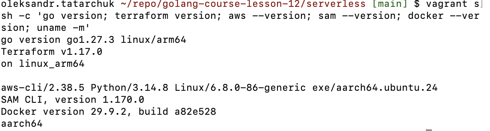 |
| S2 | демо: `make test` і `make build` | 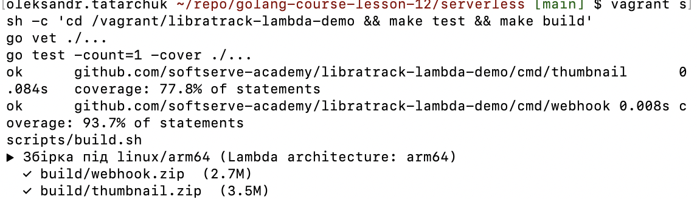 |
| S3 | демо: `sam build` і `sam local invoke` — 200 і 400 | 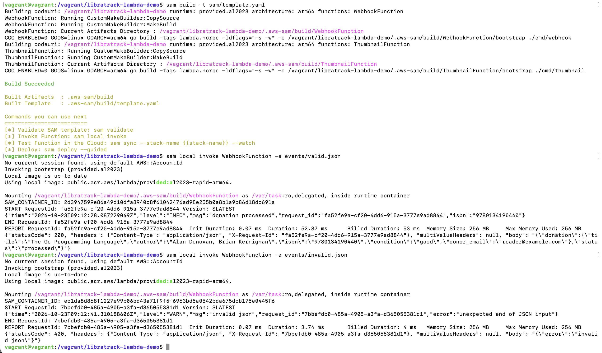 |
| S4 | демо: `sam local start-api` і `curl` — 200, 400, 400 | 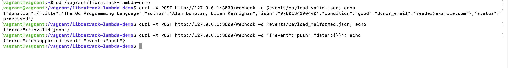 |
| S5 | демо: `make deploy-cli` у Floci і `docker ps` | 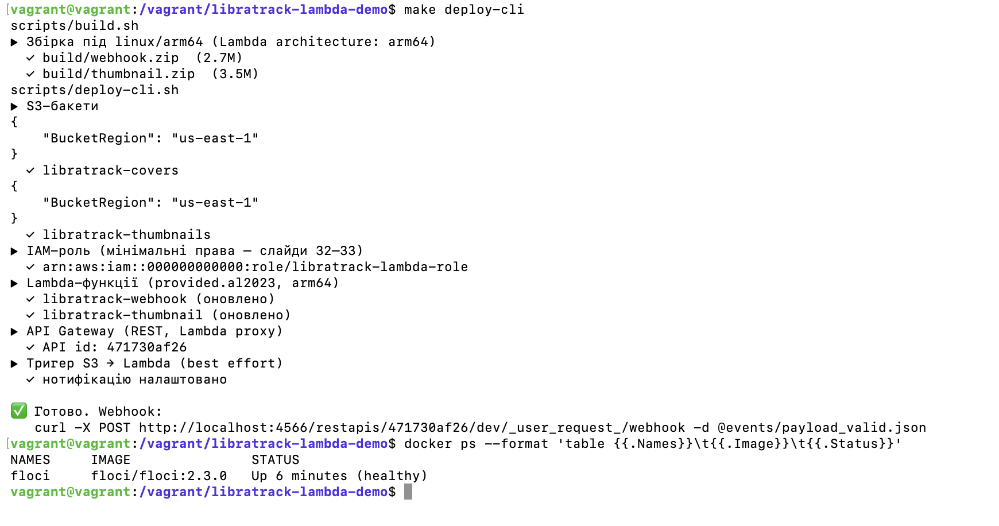 |
| S6 | демо: `aws lambda invoke` і `curl` через API Gateway — 200 і 400 | 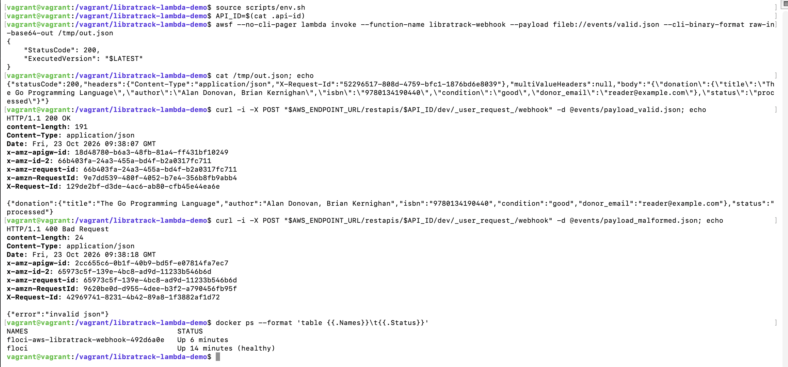 |
| S7 | демо: S3-тригер створює мініатюру 133×200 | 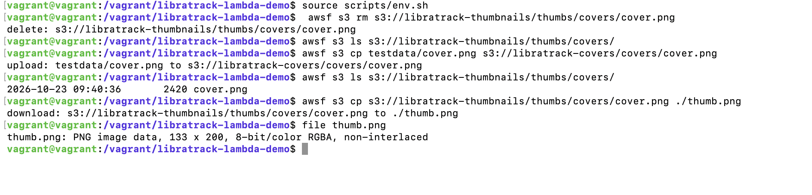 |
| S8 | демо: `make smoke` — ✅ 9 ❌ 0 | 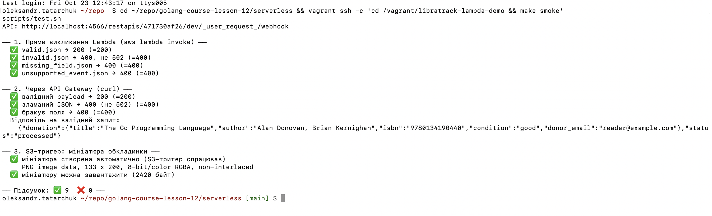 |
| S9 | веб-консоль Floci з ресурсами | 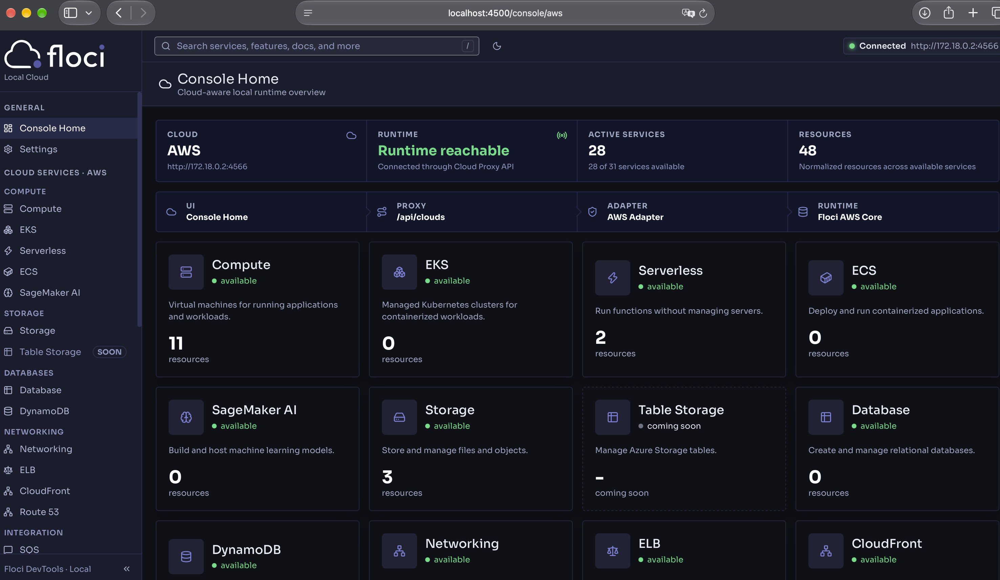 |
| S10 | демо Terraform: destroy, `Plan: 15 to add`, `Apply complete!` | 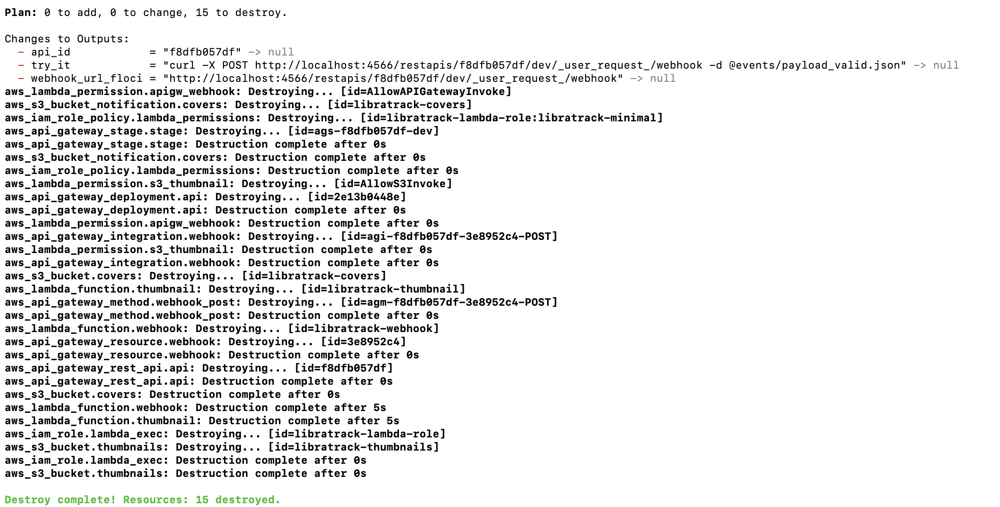 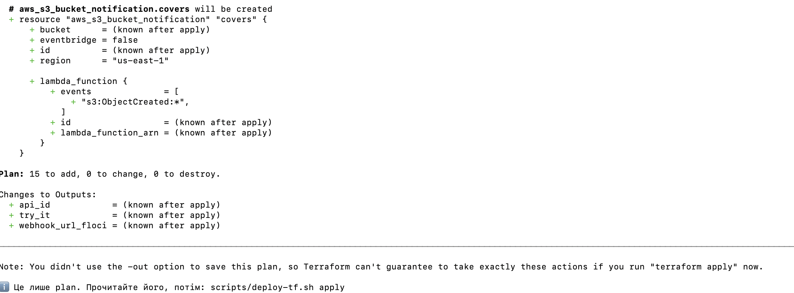 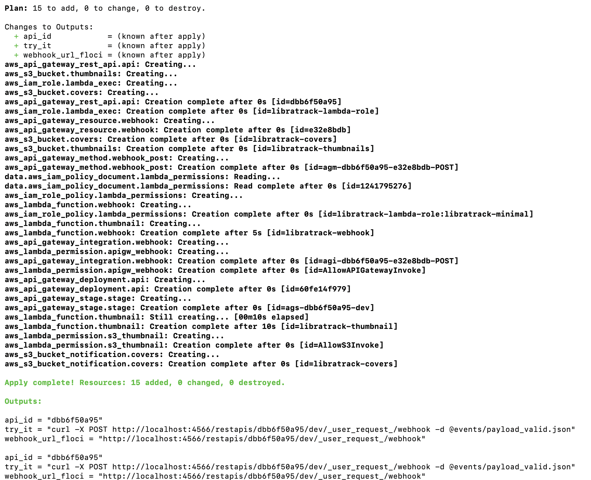 |
| S11 | демо: `make bench`, холодний проти теплого | 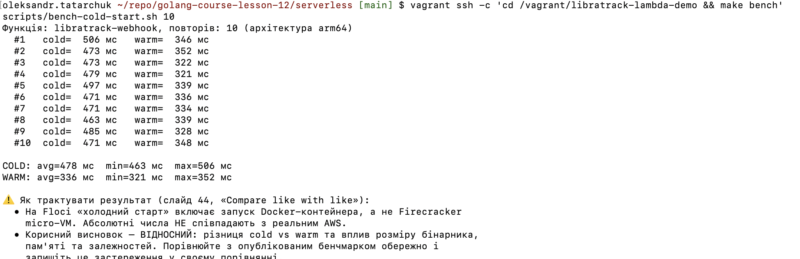 |
| S12 | власна функція: `make test`, 96 % покриття | 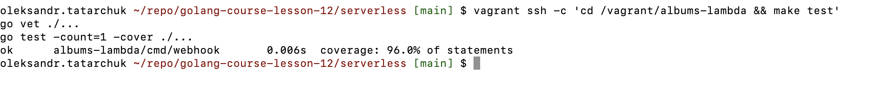 |
| S13 | власна функція: `sam local invoke` — 200, 400, 400 | 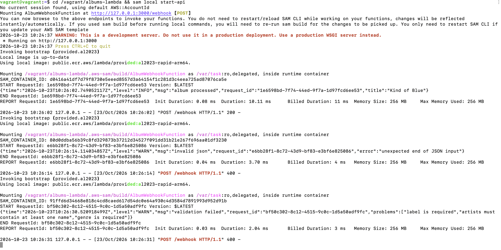 |
| S14 | власна функція: `sam local start-api` і `curl` | 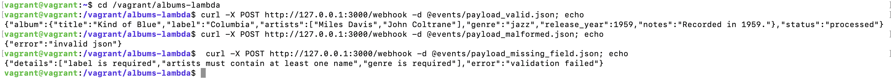 |
