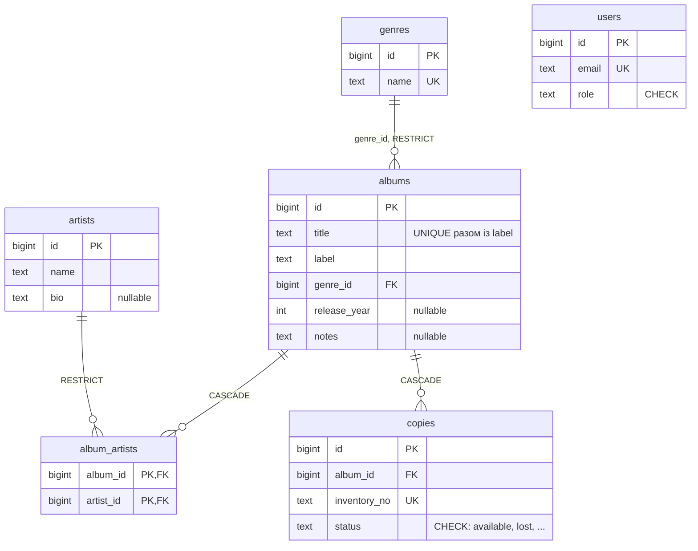

# Albums API

REST-сервіс обліку музичних альбомів на Go. Проєкт виконано в межах курсу «Go with GenAI»,
варіант `albums`: ресурс `/api/v1/albums` з обов'язковими полями `title`, `artist`, `label`,
`genre` (поле фільтра) та необов'язковими `release_year` (ціле) і `notes` (текст).

Тема 7 (REST API зі сховищем у пам'яті, Swagger, тести) виконана. Тема 8 (PostgreSQL, GORM,
міграції, виправлення N+1) у роботі: умова, адаптована під варіант `albums`, лежить у
[albums_lesson8_homework.md](albums_lesson8_homework.md), поточний стан описано в розділі
[Lesson 8 Report](#lesson-8-report-інтеграція-бд-та-оптимізація-gorm).

## Швидкий запуск

Потрібен Go 1.22 або новіший. Сторонніх сервісів поки немає: сховище в пам'яті, після перезапуску
дані зникають, `id` знову починаються з 1.

```sh
# 1. Клонувати репозиторій
git clone https://github.com/tatarchuk/golang-course-lesson-8.git && cd golang-course-lesson-8

# 2. Запустити сервер (http://localhost:8080)
go run ./cmd/api

# Інший порт або зібраний бінарник
PORT=9090 go run ./cmd/api
go build -o api ./cmd/api && ./api
```

Перевірка: `curl -s localhost:8080/health` → `{"status":"ok"}`. Кожен запит логується на сервері як
`METHOD /path -> status (duration)`.

> **TODO (Тема 8):** після інтеграції PostgreSQL запуск виглядатиме так: `cp .env.example .env`,
> `docker compose up -d`, `migrate -path migrations -database "$DATABASE_URL" up`, а сервер
> читатиме `DATABASE_URL`, `MIGRATIONS_PATH` і `PORT` (саме так його запускає CI).

### Тести та перевірки

```sh
go test -race -count=1 ./...                 # усі тести
go test ./internal/app -run TestStage4 -v    # один етап Теми 7
gofmt -l .                                   # має нічого не вивести
go vet ./...
```

Окрім офіційних тестів етапів 1–5 Теми 7, є власні: валідація моделі та `null` у JSON; сховище
(сортування, фільтр, пагінація, невикористання `id`, паралельні створення); парсинг `id` і
`page`/`limit`; формат помилок; middleware (паніка → 500, CORS, логування); граничні випадки
контракту через `NewRouter()`.

CI ([.github/workflows/theme8-check.yml](.github/workflows/theme8-check.yml)) перевіряє вже вимоги
Теми 8: структуру файлів, `gofmt`/`go vet`/`go build`, міграції на PostgreSQL, тести з реальною БД
та smoke-тест API. Він залишатиметься червоним, доки Тема 8 не завершена.

### Документація API

- Swagger UI із запуском запитів з браузера: <http://localhost:8080/swagger/index.html>.
- Специфікація OpenAPI: [docs/swagger.yaml](docs/swagger.yaml), [docs/swagger.json](docs/swagger.json).
- Runbook із `curl`-запитами на всі випадки контракту та очікуваними відповідями: [docs/CURL.md](docs/CURL.md).

Специфікацію згенеровано утилітою [swag](https://github.com/swaggo/swag) з анотацій у `cmd/api/main.go`
та `internal/handler/album.go`. Після зміни анотацій, обробників чи моделі:

```sh
go run github.com/swaggo/swag/cmd/swag@latest init -g cmd/api/main.go -o docs -ot go,yaml,json --parseInternal
```

## API (поточний контракт Теми 7)

### Ресурс

```json
{
  "id": 1,
  "title": "Kind of Blue",
  "artist": "Miles Davis",
  "label": "Columbia",
  "genre": "jazz",
  "release_year": 1959,
  "notes": null,
  "created_at": "2026-10-06T10:30:01.236249Z",
  "updated_at": "2026-10-06T10:30:01.236249Z"
}
```

| Поле | Тип | Обов'язкове | Примітка |
|---|---|---|---|
| `id` | ціле | — | видає сервер, починається з 1, ніколи не повторюється |
| `title`, `artist`, `label` | рядок | так | не порожні й не лише з пробілів |
| `genre` | рядок | так | поле фільтра у списку |
| `release_year` | ціле | ні | `null`, якщо не задано |
| `notes` | рядок | ні | `null`, якщо не задано |
| `created_at`, `updated_at` | RFC 3339 | — | видає сервер; `PUT` змінює лише `updated_at` |

### Ендпоінти

| Метод і шлях | Успіх | Помилки |
|---|---|---|
| `GET /health` | `200` `{"status":"ok"}` | |
| `POST /api/v1/albums` | `201` + створений ресурс | `422` |
| `GET /api/v1/albums` | `200` + масив | `400` `invalid_pagination` |
| `GET /api/v1/albums/{id}` | `200` + ресурс | `400` `invalid_id`, `404` |
| `PUT /api/v1/albums/{id}` | `200` + збережений ресурс | `400`, `422`, `404` |
| `DELETE /api/v1/albums/{id}` | `204` без тіла | `400`, `404` |
| `GET /swagger/` | Swagger UI | |

- **Список:** `GET /api/v1/albums?page=1&limit=10&genre=jazz`. Порядок за `id`; `page` і `limit`
  типово 1 і 10, мають бути цілими `>= 1`, `limit` понад 100 обрізається до 100; фільтр `genre` —
  точний збіг, чутливий до регістру, порожнє значення означає «без фільтра». Дуже великі значення
  не дають паніки чи `500`.
- **`PUT` — повна заміна:** необов'язкові поля, яких немає в тілі, стають `null`. Порядок перевірок:
  `id` (400) → тіло (422) → існування (404); відхилений запит нічого не змінює.
- **Валідація (`422`):** відсутні, `null`, порожні або пробільні обов'язкові поля; хибний тип
  необов'язкового поля; тіло, що не є JSON-об'єктом.
- **`{id}`** — ціле від 0 до 4294967295 (`uint32`), інакше `400` `invalid_id`; коректний, але
  неіснуючий — `404` `not_found`.
- **Помилки** мають єдиний формат `{"error":{"code":"…","message":"…"}}` без внутрішніх деталей.
  Коди: `invalid_id`, `invalid_pagination`, `validation_error`, `not_found`, `internal_server_error`.
  Невідомий маршрут і непідтримуваний метод теж дають JSON `404`.
- **CORS:** кожна відповідь має `Access-Control-Allow-Origin: *`; `OPTIONS` → `204` зі списком методів.

## Структура проєкту та прийняті рішення

```
cmd/api/main.go                      запуск сервера (порт із PORT, типово 8080)
internal/app/app.go                  NewRouter(): сховище → обробники → ServeMux → ланцюжок middleware
internal/model/                      Album (відповідь), AlbumInput (тіло запиту), Validate()
internal/repository/                 інтерфейс AlbumRepository + MemoryRepository (RWMutex + map)
internal/handler/                    HTTP-обробники, парсинг параметрів, запис JSON і помилок
internal/middleware/                 Logging, Recover, CORS
docs/                                OpenAPI (згенеровано swag) і runbook з curl
albums_lesson8_homework.md           умова Теми 8, адаптована під варіант albums
db_migration_prompt.md               промпт для генерації SQL-міграцій (Тема 8, частина 1)
.github/workflows/theme8-check.yml   CI Теми 8, адаптований під варіант albums
```

- **Роутер** — стандартний `net/http` із шаблонами Go 1.22 (`"GET /api/v1/albums/{id}"`,
  `r.PathValue`); сторонні залежності лише для Swagger UI.
- **Шари.** Обробники залежать лише від інтерфейсу `AlbumRepository`, тож сховище в пам'яті можна
  замінити на PostgreSQL, не торкаючись HTTP-коду. Саме це є точкою інтеграції БД у Темі 8.
- **Сховище** тримає значення, а не вказівники: читачі отримують копії, тому `PUT` і `GET` не ділять
  одну пам'ять; `sync.RWMutex` пускає читачів паралельно; `nextID` лише зростає, тому `id` ніколи
  не повторюються. Кожен виклик `NewRouter()` створює нове порожнє сховище, без глобального стану.
- **Два типи.** `AlbumInput` не має `id` і часу, тому клієнт не може їх задати. Необов'язкові поля —
  вказівники (`*int`, `*string`) без `omitempty`: `nil` серіалізується як `null`, ключ завжди присутній.
- **Декодування** через `json.Unmarshal` усього тіла (ліміт 1 MiB): відхиляє порожнє тіло, масив,
  сміття після об'єкта та хибні типи; повідомлення не розкривають внутрішні Go-типи.
- **Параметри.** `{id}` парситься `strconv.ParseUint(s, 10, 32)` — рівно діапазон контракту;
  `page`/`limit` — `strconv.ParseInt`, переповнення трактується як «дуже велике число», а не як
  помилка сервера. Пагінація без переповнення цілих: перевірка `page-1 > len/limit` перед обчисленням
  зсуву.
- **Порядок middleware** `Logging(Recover(CORS(mux)))`: лог бачить навіть 500 від `Recover`, а
  заголовки CORS виставлені до того, як обробник міг запанікувати.
- **Час** — `time.Now().UTC()`, у відповіді RFC 3339 із суфіксом `Z`.

## Lesson 8 Report: інтеграція БД та оптимізація GORM

Умова: [albums_lesson8_homework.md](albums_lesson8_homework.md). Стан виконання:

| Частина | Що потрібно | Стан |
|---|---|---|
| 1. Промпт-інжиніринг | промпт для міграцій; `migrations/000001_init_schema.*` і `000002_seed_demo_data.*`; `migrate up` | промпт готовий, міграції ще не згенеровано |
| 2. AI-агент | моделі `Album`, `Artist`, `Genre`, `Copy`, `User`; GORM-репозиторії та обробники; `docker-compose.yml`, `.env.example`, підключення в `main.go` | не розпочато |
| 3. Вручну | логер GORM `Info`, seed, логи «до», `Preload`, логи «після», latency | не розпочато |

### Частина 1. Промпт для генерації міграцій

Промпт призначений для генерації пари up/down міграцій у форматі
[golang-migrate](https://github.com/golang-migrate/migrate) із Go-структур проєкту. На вхід подаються
структури з `internal/model` (зараз лише `Album`; після нормалізації також `Artist`, `Genre`, `Copy`
та `User`), результат — `migrations/000001_init_schema.up.sql` і `.down.sql`.
Файл промпту: [db_migration_prompt.md](db_migration_prompt.md).

Ключові вимоги, закладені в промпт:

- первинні ключі `BIGSERIAL`; усі колонки `NOT NULL`, крім тих, що відповідають вказівникам або
  необов'язковим полям структури;
- `created_at` і `updated_at` типу `TIMESTAMP NOT NULL DEFAULT now()` у кожній таблиці;
- іменовані зовнішні ключі (`CONSTRAINT fk_…`) з `ON DELETE RESTRICT` за замовчуванням; каскад лише
  з поясненням, чому він доречний;
- окремий індекс на кожну FK-колонку з іменуванням `idx_{table}_{column}`;
- `CHECK`-обмеження для полів із фіксованим набором значень;
- ідемпотентність: `CREATE TABLE IF NOT EXISTS` та `DROP TABLE IF EXISTS`;
- down-міграція повністю відкочує up-міграцію, видаляючи об'єкти у зворотному порядку створення;
- на виході лише два SQL-блоки без пояснень.

<details>
<summary>Повний текст промпту</summary>

```text
Act as a senior Go and PostgreSQL database engineer.
Your task is to generate a highly robust and production-ready up/down SQL migration pair (using golang-migrate format) based on the following Go struct(s):

---
[INSERT_YOUR_GO_STRUCTS_HERE]
---

Please generate two separate migration files:
1. `{{VERSION}}_{{NAME}}.up.sql`
2. `{{VERSION}}_{{NAME}}.down.sql`

Strict Database Design & Constraint Requirements:
1. Primary Keys: Use `BIGSERIAL` (autoincrementing 64-bit integer) for IDs.
2. Nullability: Every column must be `NOT NULL` by default. If a field in the Go struct is a pointer (e.g., *string, *int) or is explicitly optional, map it to a nullable database column.
3. Timestamps: Include `created_at TIMESTAMP NOT NULL DEFAULT now()` and `updated_at TIMESTAMP NOT NULL DEFAULT now()` on every created table.
4. Foreign Keys (FK):
    - Every foreign key must have an explicit, named constraint (e.g., `CONSTRAINT fk_albums_genre FOREIGN KEY...`).
    - Use `ON DELETE RESTRICT` as the default safety behavior for FKs to prevent accidental data loss, unless cascade deletion is explicitly reasonable (state why).
5. Performance Indexing:
    - Explicitly write SQL to create individual indexes on all Foreign Key columns.
    - Systematic naming: `idx_{table}_{column}` (e.g., `idx_albums_genre_id`).
6. Data Integrity: Add `CHECK` constraints where fields have a restricted set of valid string options (e.g., statuses, priority ranks).
7. Idempotency: Use `CREATE TABLE IF NOT EXISTS` for table generation, and `DROP TABLE IF EXISTS` for rollbacks.
8. Down Migration Rollback: The `down.sql` must completely and cleanly revert the `up.sql`. Ensure you drop foreign keys, indexes, and tables in the EXACT reverse order of their creation to avoid dependency locks.

Output Format:
Provide only two clean, copy-pasteable SQL code blocks (one for UP, one for DOWN) without conversational fluff.
```

</details>

> **TODO (Тема 8):** згенерувати міграції, перевірити `.down.sql` (зворотний порядок видалення),
> додати `000002_seed_demo_data.*` (щонайменше 8 альбомів, 20 примірників, альбом із двома
> виконавцями, виконавець із двома альбомами) і застосувати `migrate up`.

### Частина 2. Цільова схема та API

Поточна реалізація тримає одну сутність `Album` у пам'яті, де `artist` і `genre` — текстові поля.
Цільова схема Теми 8 за умовою та перевірками CI (ще не реалізована):



Усі таблиці мають `created_at` і `updated_at` (`TIMESTAMP NOT NULL DEFAULT now()`), на кожній
FK-колонці є індекс `idx_{table}_{column}`.

Цільовий контракт API (`/api/v1`), який перевіряє smoke-тест CI:

| Запит | Відповідь |
|---|---|
| `POST /genres` `{"name"}`; `GET /genres`, `GET /genres/{id}` | `201`; дубль імені → `409` `conflict`; порожнє ім'я → `422`; невідомий `id` → `404` |
| `POST /artists` `{"name"}`; `GET /artists`, `GET /artists/{id}` | `201`; невідомий `id` → `404` |
| `POST /albums` `{"title","label","genre_id","artist_ids"}` (+ `release_year`, `notes`) | `201` із вкладеними `genre` та `artists`; дубль `title`+`label` → `409`; невідомий `genre_id`/`artist_id` → `422` `invalid_reference`; відсутній `title` або порожній `artist_ids` → `422` `validation_error` |
| `GET /albums?genre_id=&page=&limit=`; `GET /albums/{id}` | `200`; невідомий `id` → `404` `not_found` |
| `PUT /albums/{id}` (те саме тіло) | `200`, список виконавців замінюється; `404` |
| `DELETE /albums/{id}` | `204`; каскадом видаляє `copies` та `album_artists`; `404` |
| `POST /albums/{id}/copies` `{"inventory_no"}` (+ `status`); `GET /albums/{id}/copies` | `201`, `status` типово `available`; дубль `inventory_no` → `409`; хибний `status` → `422`; невідомий альбом → `404` |
| `GET /albums/{id}/availability` | `200` `{"album_id","total_copies","available_copies"}`; `404` |

> **TODO (Тема 8):** оновити моделі (`Genre`, `Artists []Artist` з тегом `many2many:album_artists`),
> реалізувати GORM-репозиторії та обробники для `albums`, `artists`, `genres`, `copies`, додати
> `docker-compose.yml`, `.env.example`, підключення та пул з'єднань у `cmd/api/main.go`. Офіційні
> тести Теми 7 в `internal/app` після зміни контракту потрібно оновити або замінити тестами Теми 8.

### Частина 3. Докази виправлення N+1

Поточне сховище в пам'яті виконує один прохід по `map` і сортування, тому проблеми N+1 ще немає.
Вона з'явиться разом із GORM, якщо `List` довантажуватиме зв'язки в циклі: 1 запит на список +
N запитів до `artists` + N до `genres`. Виправлення — `.Preload("Artists").Preload("Genre")` у
методі `List`, після чого кількість запитів стала (CI очікує від 1 до 6 `SELECT` незалежно від
кількості альбомів).

Логи GORM до виправлення (`logger.Info`, `GET /api/v1/albums`):

```text
TODO: вставити фрагмент логу з повторюваними SELECT ... FROM "artists" / "genres" для кожного альбому
```

Логи після виправлення:

```text
TODO: вставити фрагмент логу з Preload: SELECT ... WHERE "album_id" IN (...) та "id" IN (...)
```

| Показник (`GET /api/v1/albums`, тестовий набір) | До (N+1) | Після (`Preload`) |
|---|---|---|
| Кількість SQL-запитів | — | — |
| Середній час відповіді, мс | — | — |

> **TODO (Тема 8):** заповнити логи й таблицю реальними вимірами (наприклад, `curl -w '%{time_total}'`
> у циклі або `hey`/`ab` на 50–100 запитів).
