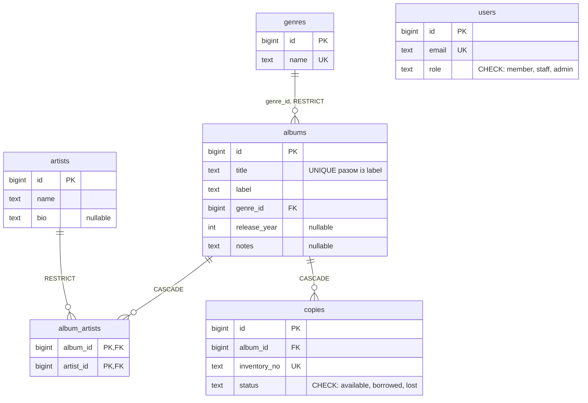

# Albums API

REST-сервіс обліку музичних альбомів на Go з PostgreSQL. Проєкт виконано в межах курсу
«Go with GenAI», варіант `albums`. Тема 7 дала REST API зі сховищем у пам'яті; Тема 8 переводить
його на PostgreSQL через GORM і golang-migrate, нормалізує схему (жанри, виконавці, примірники),
запускає все через Docker Compose і документує діагностику проблеми N+1.

Умова Теми 8, адаптована під варіант `albums`: [albums_lesson8_homework.md](albums_lesson8_homework.md).
Звіт про виконання: розділ [Lesson 8 Report](#lesson-8-report-інтеграція-бд-та-оптимізація-gorm).

## Швидкий запуск (Docker Compose)

Потрібен Docker з Compose v2. PostgreSQL 16 і API піднімаються разом; міграції (схема та
демо-дані: 3 жанри, 6 виконавців, 10 альбомів, 24 примірники) застосовуються автоматично на старті.

```sh
# 1. Клонувати репозиторій
git clone https://github.com/tatarchuk/golang-course-lesson-8.git && cd golang-course-lesson-8

# 2. Конфігурація (значення збігаються зі стандартними в docker-compose.yml)
cp .env.example .env

# 3. Зібрати образ і запустити PostgreSQL + API (http://localhost:8080)
docker compose up -d --build

# 4. Перевірити
curl -s localhost:8080/health                      # {"status":"ok"}
curl -s 'localhost:8080/api/v1/albums?limit=2'     # демо-дані з жанром і виконавцями
docker compose logs -f api                         # кожен SQL-запит потрапляє в лог
docker compose down                                # зупинити; дані лишаються у volume pgdata
```

Те саме через `make up`, `make logs`, `make down` (усі цілі: `make` без аргументів показує Makefile).

### Запуск на хості

Потрібен Go 1.25.11 або новіший (версія з `go.mod`). База береться з compose, сервер запускається
локально і так само застосовує міграції на старті.

```sh
docker compose up -d postgres        # або make db
set -a; . ./.env; set +a             # DATABASE_URL, MIGRATIONS_PATH, PORT
go run ./cmd/api                     # або make run
```

| Змінна | Призначення | Типово |
|---|---|---|
| `DATABASE_URL` | рядок підключення PostgreSQL, обов'язкова | — |
| `MIGRATIONS_PATH` | тека з міграціями golang-migrate | `migrations` |
| `PORT` | порт HTTP-сервера | `8080` |
| `DB_LOG_LEVEL` | логер GORM: `info` (кожен запит), `warn`, `error`, `silent` | `info` |

### Тести та перевірки

```sh
docker compose up -d postgres                 # базу albums_test створює scripts/initdb на першому старті
make test                                     # go test ./... -race -count=1 з TEST_DATABASE_URL із .env
go test ./internal/model ./internal/handler ./internal/middleware   # без бази даних
gofmt -l . && go vet ./...
scripts/smoke.sh http://localhost:8080        # повтор API smoke-тесту CI проти запущеного сервера
```

Тести з базою (`internal/repository`, `internal/app`) читають `TEST_DATABASE_URL`; без неї вони
пропускаються, а в CI змінна задана, тож пропусків немає. Пакети, що працюють із базою,
серіалізуються advisory-lock'ом (`internal/testdb`), кожен тест починає з порожніх таблиць.

- `internal/model`: валідація вхідних структур, `null` для необов'язкових полів, хибні JSON-типи.
- `internal/repository`: інтеграційні тести з реальною БД: створення зі зв'язками, невідомий жанр або
  виконавець (`invalid_reference`, фантомний виконавець не створюється), дублікати (`conflict`),
  список із фільтром і пагінацією, повна заміна у `PUT`, каскад при видаленні, примірники та
  доступність, ідемпотентність міграцій, guard-тест `TestListQueryCountIsConstant` на N+1.
- `internal/handler`: обробники з фейковими репозиторіями: порядок перевірок, коди помилок, парсинг.
- `internal/app`: e2e через `NewRouter()` і реальну БД: той самий сценарій, що й smoke-тест CI, плюс
  граничні випадки контракту Теми 7.
- `internal/middleware`: паніка → 500, CORS, логування.

Guard-тест `TestListQueryCountIsConstant` стежить, щоб кількість запитів у `List` не залежала від
кількості альбомів. CI ([.github/workflows/theme8-check.yml](.github/workflows/theme8-check.yml))
перевіряє структуру файлів, статичні правила, міграції на PostgreSQL, тести з реальною БД і
smoke-тест API; локальний повтор smoke-тесту (`scripts/smoke.sh`) дає 59/59.

### Документація API

- Swagger UI із запуском запитів з браузера: <http://localhost:8080/swagger/index.html>.
- Специфікація OpenAPI: [docs/swagger.yaml](docs/swagger.yaml), [docs/swagger.json](docs/swagger.json).
- Runbook із `curl`-запитами на всі випадки контракту: [docs/CURL.md](docs/CURL.md).

Специфікацію згенеровано утилітою [swag](https://github.com/swaggo/swag) з анотацій у `cmd/api/main.go`
та обробниках `internal/handler/*_handler.go`; після їх зміни: `make swagger`.

## API

Усі відповіді, крім `204`, мають `Content-Type: application/json`; ключі в `snake_case`.
Необов'язкові поля завжди присутні у відповіді (`null`, якщо не задані); час у RFC 3339 (UTC, `Z`).

### Ресурси

```json
{
  "id": 1,
  "title": "Kind of Blue",
  "label": "Columbia",
  "genre_id": 1,
  "genre": {"id": 1, "name": "jazz", "created_at": "2026-10-09T10:00:00Z", "updated_at": "2026-10-09T10:00:00Z"},
  "artists": [
    {"id": 1, "name": "Miles Davis", "bio": "Trumpeter and bandleader.", "created_at": "...", "updated_at": "..."},
    {"id": 2, "name": "John Coltrane", "bio": null, "created_at": "...", "updated_at": "..."}
  ],
  "release_year": 1959,
  "notes": null,
  "created_at": "2026-10-09T10:00:00Z",
  "updated_at": "2026-10-09T10:00:00Z"
}
```

Тіло `POST`/`PUT /albums` посилається на жанр і виконавців за `id`:

| Поле | Тип | Обов'язкове | Примітка |
|---|---|---|---|
| `title`, `label` | рядок | так | не порожні й не лише з пробілів; пара `title` + `label` унікальна |
| `genre_id` | ціле | так | має існувати, інакше `422` `invalid_reference` |
| `artist_ids` | масив цілих | так | непорожній, без повторів; невідомий id → `422` `invalid_reference` |
| `release_year` | ціле | ні | від 0 до 9999; `null`, якщо не задано |
| `notes` | рядок | ні | `null`, якщо не задано |

Інші ресурси: жанр `{"id","name",...}` (вхід `{"name"}`, ім'я унікальне), виконавець
`{"id","name","bio",...}` (вхід `{"name","bio"}`), примірник `{"id","album_id","inventory_no","status",...}`
(вхід `{"inventory_no","status"}`, статус `available` | `borrowed` | `lost`, типово `available`,
`inventory_no` унікальний), доступність `{"album_id","total_copies","available_copies"}`.

### Ендпоінти

| Запит | Відповідь |
|---|---|
| `GET /health` | `200` `{"status":"ok"}` |
| `POST /api/v1/genres`; `GET /api/v1/genres`, `GET /api/v1/genres/{id}` | `201`; дубль імені → `409` `conflict`; порожнє ім'я → `422`; `200`; невідомий id → `404` |
| `POST /api/v1/artists`; `GET /api/v1/artists`, `GET /api/v1/artists/{id}` | `201`; порожнє ім'я → `422`; `200`; невідомий id → `404` |
| `POST /api/v1/albums` | `201` з вкладеними `genre` та `artists`; дубль `title`+`label` → `409`; невідомі посилання → `422` `invalid_reference`; інша валідація → `422` `validation_error` |
| `GET /api/v1/albums?page=&limit=&genre_id=` | `200` масив (порожній як `[]`); `400` `invalid_pagination` або `validation_error` |
| `GET /api/v1/albums/{id}` | `200`; `400` `invalid_id`; `404` `not_found` |
| `PUT /api/v1/albums/{id}` | `200`, повна заміна, виконавці замінюються списком; `400`, `422`, `404` |
| `DELETE /api/v1/albums/{id}` | `204` без тіла; каскадом зникають примірники та зв'язки; `400`, `404` |
| `POST /api/v1/albums/{id}/copies`; `GET /api/v1/albums/{id}/copies` | `201` (`status` типово `available`); дубль `inventory_no` → `409`; хибний статус → `422`; невідомий альбом → `404` |
| `GET /api/v1/albums/{id}/availability` | `200` `{"album_id","total_copies","available_copies"}`; `404` |
| `GET /swagger/` | Swagger UI |

- **Список:** порядок за `id`; `page` і `limit` типово 1 і 10, мають бути цілими `>= 1`, `limit` понад
  100 обрізається до 100; `genre_id` — точний збіг, порожнє значення означає «без фільтра». Дуже великі
  значення не дають паніки чи `500`.
- **`PUT` — повна заміна:** необов'язкові поля, яких немає в тілі, стають `null`; `artist_ids` замінюють
  попередній список. Порядок перевірок: `id` (400) → тіло (422) → існування (404) → посилання (422);
  відхилений запит нічого не змінює (транзакція).
- **`{id}`** — ціле від 0 до 4294967295 (`uint32`), інакше `400` `invalid_id`.
- **Помилки** мають єдиний формат `{"error":{"code":"…","message":"…"}}` без внутрішніх деталей. Коди:
  `invalid_id`, `invalid_pagination`, `validation_error`, `invalid_reference`, `conflict`, `not_found`,
  `internal_server_error`. Невідомий маршрут і непідтримуваний метод дають JSON `404`.
- **CORS:** кожна відповідь має `Access-Control-Allow-Origin: *`; `OPTIONS` → `204` зі списком методів.

## Структура проєкту та прийняті рішення

```
cmd/api/main.go                      конфігурація з env, підключення, міграції, HTTP-сервер, graceful shutdown
internal/app/app.go                  NewRouter(repos): обробники → ServeMux → Logging(Recover(CORS))
internal/model/                      GORM-моделі Album, Artist, Genre, Copy, User, AlbumArtist + вхідні структури з Validate()
internal/repository/                 інтерфейси та GORM-реалізації, errors.go, db.go (Open), migrate.go (Migrate)
internal/handler/                    HTTP-обробники (*_handler.go), errors.go (коди, відображення помилок), парсинг
internal/middleware/                 Logging, Recover, CORS
internal/testdb/                     спільне підключення для тестів із БД (advisory lock, міграції, TRUNCATE)
migrations/                          000001_init_schema, 000002_seed_demo_data (up/down)
docs/                                OpenAPI (swag) і runbook з curl
scripts/                             initdb/ (бази для тестів), smoke.sh (smoke-тест CI), measure_n1.sh (N+1)
Dockerfile, docker-compose.yml       образ API (multi-stage) і стек postgres + api
Makefile, .env.example               щоденні команди та приклад конфігурації
albums_lesson8_homework.md           умова Теми 8, адаптована під варіант albums
db_migration_prompt.md               промпт для генерації SQL-міграцій (частина 1)
.github/workflows/theme8-check.yml   CI Теми 8, адаптований під варіант albums
```

- **Шари.** Обробники залежать лише від інтерфейсів `AlbumRepository`, `ArtistRepository`,
  `GenreRepository`, `CopyRepository`; `NewRouter` отримує їх структурою `repository.Repositories`, тож
  тести обробників працюють на фейках, а `main` передає GORM-реалізації.
- **Інтерфейс `AlbumRepository`** зберіг п'ять методів Теми 7; додано лише `ctx context.Context`,
  який прокидається в кожен запит через `.WithContext(ctx)`.
- **Запис альбому** виконується в транзакції: спочатку перевіряються жанр і виконавці (невідомий id →
  `ErrInvalidReference`), потім вставляється рядок `albums` з `Omit(clause.Associations)`, а рядки
  `album_artists` пишуться явно. Якби асоціації віддати GORM, він би зробив upsert виконавця з
  невідомим id і мовчки створив порожній запис.
- **`PUT`** оновлює колонки через `Select(...)`, тому `nil`-вказівники пишуться як `NULL`
  (повна заміна), а зв'язки перезаписуються (delete + insert) у тій самій транзакції.
- **Помилки драйвера** перекладаються один раз: `TranslateError: true` дає `gorm.ErrDuplicatedKey`,
  `ErrForeignKeyViolated`, `ErrCheckConstraintViolated`, які `translate()` відображає на
  `ErrConflict`, `ErrInvalidReference`, `ErrInvalidInput`; обробники мапують їх на 409/422.
- **Схема лише через міграції:** `AutoMigrate` не використовується; `Migrate()` запускає golang-migrate
  як бібліотеку (джерело `iofs`, драйвер `pgx/v5`) на старті застосунку, тому порожня база отримує
  схему й демо-дані ще до першого запиту.
- **Каскади** оголошені в БД: видалення альбому прибирає його примірники та зв'язки з виконавцями;
  жанри й виконавці захищені `ON DELETE RESTRICT`.
- **Логер GORM** на рівні `info` пише кожен SQL-запит у stdout одним рядком — саме так
  рахується кількість `SELECT` для N+1 (локально, у `scripts/measure_n1.sh` і в CI). Пул:
  25 відкритих, 5 простоюючих з'єднань, lifetime 30 хв; `NowFunc` у UTC.
- **Середовище:** образ збирається у два етапи (статичний бінарник + `migrations/` на alpine, non-root);
  у compose API чекає на `healthcheck` PostgreSQL і з'єднується з хостом `postgres`.

## Lesson 8 Report: інтеграція БД та оптимізація GORM

Умова: [albums_lesson8_homework.md](albums_lesson8_homework.md). Стан виконання:

| Частина | Що потрібно | Стан |
|---|---|---|
| 1. Промпт-інжиніринг | промпт для міграцій; `migrations/000001_init_schema.*` і `000002_seed_demo_data.*`; `migrate up` | готово |
| 2. AI-агент | моделі `Album`, `Artist`, `Genre`, `Copy`, `User`; GORM-репозиторії та обробники; `docker-compose.yml`, `.env.example`, підключення в `main.go` | готово |
| 3. Вручну | логер GORM `Info`, демо-дані, логи «до», `Preload`, логи «після», latency | готово: 21 → 4 запити, 2.84 → 1.33 мс |

### Частина 1. Промпт для генерації міграцій

Промпт призначений для генерації пари up/down міграцій у форматі
[golang-migrate](https://github.com/golang-migrate/migrate) із Go-структур проєкту. На вхід подано
структури з `internal/model` (`Album`, `Artist`, `Genre`, `AlbumArtist`, `Copy`, `User`); результат —
[migrations/000001_init_schema.up.sql](migrations/000001_init_schema.up.sql) та
[`.down.sql`](migrations/000001_init_schema.down.sql). Демо-дані винесено в окрему пару
[000002_seed_demo_data](migrations/000002_seed_demo_data.up.sql), яка наприкінці пересуває
послідовності (`setval`), щоб записи через API не конфліктували з явними id.
Файл промпту: [db_migration_prompt.md](db_migration_prompt.md).

Ключові вимоги, закладені в промпт:

- первинні ключі `BIGSERIAL`; усі колонки `NOT NULL`, крім тих, що відповідають вказівникам або
  необов'язковим полям структури;
- `created_at` і `updated_at` типу `TIMESTAMP NOT NULL DEFAULT now()` у кожній таблиці;
- іменовані зовнішні ключі (`CONSTRAINT fk_…`) з `ON DELETE RESTRICT` за замовчуванням; каскад лише
  з поясненням, чому він доречний;
- окремий індекс на кожну FK-колонку з іменуванням `idx_{table}_{column}`;
- `CHECK`-обмеження для полів із фіксованим набором значень;
- ідемпотентність: `CREATE TABLE IF NOT EXISTS` та `DROP TABLE IF EXISTS`;
- down-міграція повністю відкочує up-міграцію, видаляючи об'єкти у зворотному порядку створення;
- на виході лише два SQL-блоки без пояснень.

<details>
<summary>Повний текст промпту</summary>

```text
Act as a senior Go and PostgreSQL database engineer.
Your task is to generate a highly robust and production-ready up/down SQL migration pair (using golang-migrate format) based on the following Go struct(s):

---
[INSERT_YOUR_GO_STRUCTS_HERE]
---

Please generate two separate migration files:
1. `{{VERSION}}_{{NAME}}.up.sql`
2. `{{VERSION}}_{{NAME}}.down.sql`

Strict Database Design & Constraint Requirements:
1. Primary Keys: Use `BIGSERIAL` (autoincrementing 64-bit integer) for IDs.
2. Nullability: Every column must be `NOT NULL` by default. If a field in the Go struct is a pointer (e.g., *string, *int) or is explicitly optional, map it to a nullable database column.
3. Timestamps: Include `created_at TIMESTAMP NOT NULL DEFAULT now()` and `updated_at TIMESTAMP NOT NULL DEFAULT now()` on every created table.
4. Foreign Keys (FK):
    - Every foreign key must have an explicit, named constraint (e.g., `CONSTRAINT fk_albums_genre FOREIGN KEY...`).
    - Use `ON DELETE RESTRICT` as the default safety behavior for FKs to prevent accidental data loss, unless cascade deletion is explicitly reasonable (state why).
5. Performance Indexing:
    - Explicitly write SQL to create individual indexes on all Foreign Key columns.
    - Systematic naming: `idx_{table}_{column}` (e.g., `idx_albums_genre_id`).
6. Data Integrity: Add `CHECK` constraints where fields have a restricted set of valid string options (e.g., statuses, priority ranks).
7. Idempotency: Use `CREATE TABLE IF NOT EXISTS` for table generation, and `DROP TABLE IF EXISTS` for rollbacks.
8. Down Migration Rollback: The `down.sql` must completely and cleanly revert the `up.sql`. Ensure you drop foreign keys, indexes, and tables in the EXACT reverse order of their creation to avoid dependency locks.

Output Format:
Provide only two clean, copy-pasteable SQL code blocks (one for UP, one for DOWN) without conversational fluff.
```

</details>

Аналіз результату: `.down.sql` видаляє індекси, обмеження й таблиці у зворотному порядку; обидві
пари перевірено так само, як це робить CI (`migrate` v4.17.1: `up` → SQL-проби `CHECK`, `UNIQUE`,
`FK`, каскад → `down -all` → `up`), а також тестом `TestMigrateIsIdempotentAndCreatesEveryTable`.

### Частина 2. Схема та реалізація

Схема після нормалізації (`artist` і `genre` перестали бути текстовими полями альбому):



Усі таблиці мають `created_at` і `updated_at`, на кожній FK-колонці є індекс `idx_{table}_{column}`.
Модель `Album` описує зв'язки тегами GORM: `Genre Genre \`gorm:"foreignKey:GenreID"\`` та
`Artists []Artist \`gorm:"many2many:album_artists;"\``. Реалізацію репозиторіїв, обробників,
підключення (`internal/repository/db.go`, пул `SetMaxOpenConns`/`SetMaxIdleConns`) і стека
Docker Compose описано в розділі «Структура проєкту та прийняті рішення»; контракт API — у розділі «API».

### Частина 3. Докази виправлення N+1

**Діагностика.** Перша версія методу `List` у `internal/repository/album_repository.go` після вибірки
сторінки альбомів довантажувала жанр і виконавців у циклі — по два запити на кожен альбом (1 + 2N).
На демо-даних (10 альбомів) один `GET /api/v1/albums?limit=100` давав 21 `SELECT`, а guard-тест
`TestListQueryCountIsConstant` фіксував 5 запитів для 2 альбомів і 21 для 10. Виміряно
`scripts/measure_n1.sh` проти стека Docker Compose (macOS, Docker Desktop).

Логи GORM **до** виправлення (`DB_LOG_LEVEL=info`, один запит, 21 `SELECT`; перші шість рядків,
повний вивід у [docs/n1/before.txt](docs/n1/before.txt)):

```text
[1.295ms] [rows:10] SELECT * FROM "albums" ORDER BY id LIMIT 100
[0.377ms] [rows:1] SELECT * FROM "genres" WHERE "genres"."id" = 1 ORDER BY "genres"."id" LIMIT 1
[0.420ms] [rows:3] SELECT "artists"."id","artists"."name",... FROM "artists" JOIN "album_artists" ON ... WHERE "album_artists"."album_id" = 1
[0.185ms] [rows:1] SELECT * FROM "genres" WHERE "genres"."id" = 1 ORDER BY "genres"."id" LIMIT 1
[0.161ms] [rows:1] SELECT "artists"."id","artists"."name",... FROM "artists" JOIN "album_artists" ON ... WHERE "album_artists"."album_id" = 2
[0.101ms] [rows:1] SELECT * FROM "genres" WHERE "genres"."id" = 1 ORDER BY "genres"."id" LIMIT 1
... (ще 15 таких самих пар на решту альбомів)
```

**Виправлення.** Цикл замінено пакетним довантаженням зв'язків у тому самому запиті:

```go
q := r.db.WithContext(ctx).Preload("Artists").Preload("Genre").Order("id")
// далі фільтр за genre_id, Offset/Limit, Find(&albums) і лише normalizeAlbum для кожного альбому
```

Логи **після** виправлення (той самий запит, 4 `SELECT`: сторінка альбомів, зв'язки `album_artists`,
виконавці та жанри через `WHERE id IN (...)`; повний вивід у [docs/n1/after.txt](docs/n1/after.txt)):

```text
[0.578ms] [rows:12] SELECT * FROM "album_artists" WHERE "album_artists"."album_id" IN (1,2,3,4,5,6,7,8,9,10)
[0.487ms] [rows:6] SELECT * FROM "artists" WHERE "artists"."id" IN (1,2,6,3,4,5)
[0.429ms] [rows:3] SELECT * FROM "genres" WHERE "genres"."id" IN (1,2,3)
[4.833ms] [rows:10] SELECT * FROM "albums" ORDER BY id LIMIT 100
```

GORM друкує рядок головного запиту останнім, бо його тривалість включає preload-запити.

| Показник (`GET /api/v1/albums?limit=100`, 10 альбомів) | До (цикл, N+1) | Після (`Preload`) |
|---|---|---|
| Кількість `SELECT` на один запит | 21 (1 + 2 x 10) | 4, стала, не залежить від кількості альбомів |
| Середній час відповіді (`ab -n 200 -c 1`) | 2.84 мс (p50 3, p95 4, p99 5 мс; 352 req/s) | 1.33 мс (p50 1, p95 2, p99 3 мс; 753 req/s) |

Після виправлення guard-тест зелений, `scripts/smoke.sh` дає 59/59
([docs/n1/smoke.txt](docs/n1/smoke.txt)), і перевірка CI «constant number of SELECTs» бачить ті самі
4 запити до і після додавання п'яти альбомів. Відтворити: `make up`, потім `scripts/measure_n1.sh`.
