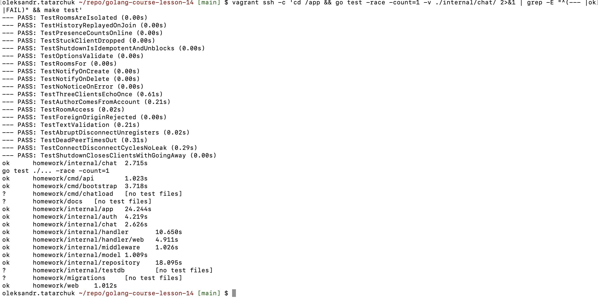
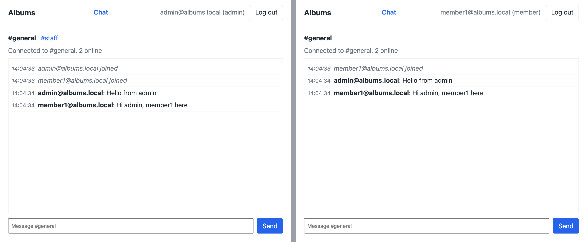

# Albums: живий чат

Каталог музичних альбомів на Go: REST API, PostgreSQL і GORM, JWT і ролі, вебінтерфейс на htmx з cookie-сесією,
serverless-частина. Усе це зроблено в Темах 8–12 курсу «Go with GenAI», варіант `albums`. У Темі 14 до застосунку
додано онлайн-чат на WebSockets.

Репозиторій продовжує історію [golang-course-lesson-12](https://github.com/tatarchuk/golang-course-lesson-12); повний
довідник API (ендпоінти, ролі, приклади запитів) лишився в його README. Приклади з презентації Теми 14 — в окремому
репозиторії [golang-course-lesson-14-examples](https://github.com/tatarchuk/golang-course-lesson-14-examples).

Умова Теми 14, адаптована під варіант `albums`, для обох репозиторіїв: [albums_lesson14_homework.md](albums_lesson14_homework.md).

## Як запустити

Застосунок і PostgreSQL працюють у Docker усередині Vagrant-VM (VirtualBox, Ubuntu 24.04 arm64). Браузер працює на Mac,
порт 8080 проброшено на `127.0.0.1` Mac.

```bash
cp .env.example .env                                   # JWT_SECRET замінити на: openssl rand -base64 48
vagrant up --provision-with docker-engine,go           # VM albums-lesson14: Docker і Go 1.27.3 для тестів
vagrant ssh -c 'cd /app && make up && make bootstrap'  # PostgreSQL + api, адміністратор admin@albums.local
```

Чат: `http://localhost:8080/login`, потім **Chat** у верхньому меню. Демо-акаунти member і staff для другого браузера
(або приватного вікна: один профіль браузера — один cookie) створює [docs/CURL.md](docs/CURL.md), розділ 9.

```bash
vagrant ssh -c 'cd /app && make test'              # go test ./... -race з тестовою базою
vagrant ssh -c 'cd /app && bash scripts/smoke.sh'  # API, вебінтерфейс і цикли чату, як у CI
make chatload ARGS="-clients 50 -cycles 10"         # з Mac: цикли підключення/відключення, горутини до і після
```

## Структура проєкту

Те, що додала Тема 14; решта — як у Темах 8–12 (README Теми 12).

```
cmd/api/main.go             створює хаб чату, go hub.Run(), srv.RegisterOnShutdown(hub.Shutdown)
cmd/chatload/               термінальний клієнт: цикли підключення/відключення, статистика до і після
internal/chat/
  hub.go                    реєстр кімнат h.rooms, ним володіє лише горутина Run; історія, presence
  client.go                 readPump і writePump (єдиний писач у з'єднання), ping/pong, ліміти
  handler.go                рукостискання: кімната, акаунт, Origin; потім upgrade
  albums.go                 NotifyAlbums: декоратор репозиторію альбомів, сповіщення в #general
  message.go                кадри і налаштування (DefaultOptions)
internal/handler/web/chat.go  сторінка /chat
internal/middleware/logging.go  statusWriter із Hijack і Unwrap
web/templates/chat.html, web/static/chat.js  сторінка чату і її скрипт
docs/chat/                  журнали Теми 14; docs/screenshots/chat/ — скриншоти
```

## Lesson 14 Report: Live Chat

### Оцінювання

| Завдання | Бали | Де |
|---|---|---|
| Запустити приклади з презентації на власному ПК; перевірити `go test -race` і ручним тестуванням повторних циклів підключення/відключення | 70 | [golang-course-lesson-14-examples](https://github.com/tatarchuk/golang-course-lesson-14-examples) |
| Додати до свого застосунку онлайн-чат | не вказано | цей репозиторій |

Чат вбудовано в застосунок Тем 8–12: та сама сесія, ті самі ролі, той самий REST API. Фінальна презентація (пункт 3
слайда 48) у тексті оцінювання відсутня і не виконувалася.

### Середовище

VM `albums-lesson14` (кореневий Vagrantfile, провіжнери `docker-engine` і новий `go`): Ubuntu 24.04.3 arm64, 4 CPU,
Docker 29.9.2, Compose v5.6.1, Go 1.27.3 і gcc для `go test -race`. Mac: macOS 27.2, Go 1.27.1, Chrome 156.
`github.com/gorilla/websocket` v1.5.3, як на слайді 12 і в прикладах ([environment.txt](docs/chat/environment.txt)).

### Як працює чат

| Що | Як |
|---|---|
| Сторінка | `GET /chat`; анонімного відвідувача переадресовує на `/login`; посилання лише на кімнати, дозволені ролі; невідома чи заборонена `?room=` дає `general` |
| З'єднання | `GET /ws/chat?room=general\|staff` за `CookieAuth` і `RequireRole(member, staff, admin)`: cookie `albums_token` іде з рукостисканням, тож токен в URL не потрапляє |
| До upgrade | кімната (`staff` лише для staff і admin, інакше 403; невідома — 404), акаунт за `user_id` із claims (видалений — 401), Origin дорівнює `Host` (інший або відсутній — 403), зупинений хаб — 503 |
| Повідомлення | клієнт надсилає лише `{"text":"..."}`: автор — e-mail акаунта, кімната — з'єднання; 1–1000 символів після обрізання пробілів, інакше кадр `error` лише відправникові; понад 4096 байт — закриття 1009 |
| Кадри сервера | `message`, `notice`, `presence` (хто прийшов чи пішов і скільки онлайн), `history` (останні 50 повідомлень кімнати при вході, лише в пам'яті), `error` |
| REST → чат | `chat.NotifyAlbums` обгортає репозиторій альбомів: створення (API) і видалення (API чи вебінтерфейс) публікують `notice` у `general`, напр. `Album "Blue Train" (Blue Note, jazz) was added to the catalogue`; невдалий запис нічого не публікує |
| Статистика | `GET /api/v1/chat/stats`, лише admin: клієнти за кімнатами і кількість горутин сервера |
| Життєвий цикл | ping кожні 54 с, pong-тайм-аут 60 с, дедлайн запису 10 с; черга відправки 256 кадрів, клієнта з повною чергою хаб відключає кодом 1008; `Shutdown` через `srv.RegisterOnShutdown` закриває всіх кодом 1001, і процес завершується лише після того, як кожен писач надіслав кадр закриття (не довше 10 с) |

Хаб — виправлений патерн із прикладів (огляд ШІ за слайдом 42 і тести в репозиторії прикладів): реєстром володіє одна
горутина, у кожного з'єднання один писач, розсилка не блокується повільним клієнтом, зупинка ідемпотентна.

### Чим відрізняється від слайдів

| Слайд | На слайді | У застосунку | Чому |
|---|---|---|---|
| 13 | `CheckOrigin` порівнює з одним заданим джерелом | Origin має дорівнювати `Host` | та сама збірка працює на `localhost:8080` у VM і на `127.0.0.1:8080` у CI |
| 39 | токен у query-параметрі `?token=` | cookie-сесія Теми 10 (`CookieAuth`) | вебінтерфейс уже має HttpOnly cookie; query-рядок потрапляє в журнали проксі (про це попереджав і ШІ на слайд 34 у прикладах) |
| 40 | один чат | кімнати `general` і `staff` за ролями Теми 9 | у застосунку є ролі |
| 41 | сервіс сам викликає `hub.Publish` | декоратор репозиторію `NotifyAlbums` | обробники API і вебінтерфейсу не змінюються; публікується лише вдалий запис |
| 28 | розмір черги не названо | 256 | 16 і 64 переповнювалися на сценарії слайда 43 зі 100 клієнтами (див. README прикладів) |
| — | (код Теми 12) `middleware.Logging` без `Hijack` | `statusWriter` отримав `Hijack` і `Unwrap` | gorilla робить upgrade через `w.(http.Hijacker)`, тож без цього кожен upgrade відповідав 500 |

### Крок за кроком

1. **Старт від Теми 12.** Клон golang-course-lesson-12 з історією; робочий e-mail в авторах і комітерах 83 комітів
   замінено на особистий, дерева, дати й повідомлення ті самі ([history-rewrite.txt](docs/chat/history-rewrite.txt)).
2. **VM і базова лінія.** Провіжнер `go` (Go 1.27.3 і компілятор C для `-race`); код Теми 12 у VM: 296 тестів із
   `-race`, усі зелені ([baseline-tests.txt](docs/chat/baseline-tests.txt)).
3. **Блокер `Hijack`.** Знайдений ще під час планування: `Logging` загортав `ResponseWriter` без `Hijack`. Спершу тест
   `TestLoggingPassesHijackerThrough` (червоний: 500), потім виправлення (зелений: 101)
   ([hijack-fix.txt](docs/chat/hijack-fix.txt)).
4. **Тести до коду.** 26 тестів Теми 14 (нижче) написано раніше за код: пакети `chat`, `handler/web` і `app` не
   збираються ([tests-before.txt](docs/chat/tests-before.txt)).
5. **Код.** Пакет `internal/chat`, підключення в `app.go` і `main.go`, сторінка, `chat.js` (лише `textContent`,
   перепідключення з паузою від 1 до 30 с), `cmd/chatload`, Swagger для статистики. У VM 324 тести з `-race`, усі
   зелені ([tests-after.txt](docs/chat/tests-after.txt), C1).
6. **Запуск.** Свіжа база, демо-акаунти, статистика: admin 200, member 403, без токена 401; member не потрапляє в кімнату
   `staff`: 403 ще до upgrade ([run.txt](docs/chat/run.txt), розділ 1). Базовий сценарій у справжньому браузері:
   admin і member1 у `#general` у двох окремих контекстах Chrome (два набори cookie) обмінюються повідомленнями, кожне
   рівно один раз на обох сторінках, автор — із сесії; після закриття браузера сервер повертається до 0 клієнтів і 9
   горутин ([run.txt](docs/chat/run.txt), розділ 2, C2).
7. **Цикли підключення/відключення.** `scripts/smoke.sh` у VM: 107 перевірок із 107, наприкінці чат: анонімний доступ,
   статистика і 2×100 підключень через `cmd/chatload` (з кадром закриття і з обірваним TCP). У кожному циклі 400 з 400
   повідомлень, горутини сервера 9 → 9 ([smoke.txt](docs/chat/smoke.txt)). Ті самі цикли запускає CI.
8. **CI.** Статичні перевірки Теми 14 і цикли чату в інтеграційному завданні (нижче). Прогін статичного кроку локально
   (у VM) знайшов кирилицю в одному тесті: перевірка «у .go лише ASCII» впала і на GitHub. Літеру записано як
   `\u0436`, значення тесту те саме.

Сповіщення про альбоми і закриття з'єднань під час зупинки сервера перевірено тестами (`TestAlbumCreateNotifiesChat`,
`TestNotifyOn*`, `TestShutdownClosesClientsWithGoingAway`); окремих скриншотів для них немає. Рестарт сервера з
відкритими сторінками перевірено після фінального огляду (I1 нижче): `docker compose restart api`, обидві сторінки
отримали `1001 server shutdown` і за 3,1 с підключилися знову ([run.txt](docs/chat/run.txt), розділ 3). Safari не
запускався.

### Тести

| Файл | Тести | Що доводять |
|---|---|---|
| `internal/chat/hub_test.go` | `TestRoomsAreIsolated`, `TestHistoryReplayedOnJoin`, `TestPresenceCountsOnline`, `TestStuckClientDropped`, `TestShutdownIsIdempotentAndUnblocks`, `TestShutdownWaitsForWriters`, `TestOptionsValidate`, `TestRoomsFor` | кімнати ізольовані; при вході 50 останніх, найстаріше відкинуто; лічильник онлайн; клієнт, що не читає (черга 2), відключається з 1008, здоровий отримує всі 10; повторний `Shutdown` без паніки і без блокування; `Shutdown` повертається лише після кадрів закриття всіх писачів, не пізніше `WriteWait` (фінальний огляд, I1) |
| `internal/chat/handler_test.go` | `TestThreeClientsEchoOnce`, `TestAuthorComesFromAccount`, `TestRoomAccess`, `TestForeignOriginRejected`, `TestTextValidation`, `TestAbruptDisconnectUnregisters`, `TestDeadPeerTimesOut` | три клієнти, у відправника без дубліката; `author`, `room`, `type` від клієнта нічого не змінюють; 403, 404, 401; чужий або відсутній Origin; порожній текст, 1001 символ, 5000 байт → 1009; обірване з'єднання; «мертвий» клієнт за тайм-аутом pong |
| `internal/chat/leak_test.go` | `TestConnectDisconnectCyclesNoLeak`, `TestShutdownClosesClientsWithGoingAway` | 100 клієнтів за 5 циклів (з кадром закриття і без): 0 клієнтів, горутин не більше базових + 2; зупинка — 1001 кожному |
| `internal/chat/albums_test.go` | `TestNotifyOnCreate`, `TestNotifyOnDelete`, `TestNoNoticeOnError` | сповіщення з REST; невдалий запис нічого не публікує |
| `internal/handler/web/chat_test.go` | `TestChatPageRedirectsAnonymous`, `TestChatPageRoomsByRole`, `TestChatPageScriptOnly` | анонім → `/login`; кімнати за роллю; лише зовнішній `chat.js` |
| `internal/app/chat_test.go`, `config_test.go` | `TestChatRoutesWired`, `TestAlbumCreateNotifiesChat`, `TestNewRouterPanicsWithoutChatHub` | маршрути з реальною базою: `/ws/chat` 401, 403, 101; статистика 401, 403, 200; `POST /albums` дає сповіщення за 1 с; на `/chat` діє CSP |
| `internal/middleware/middleware_test.go` | `TestLoggingPassesHijackerThrough` | upgrade крізь `Logging` → 101 |

CI (`theme8-check.yml`): статичні перевірки Теми 14 — файли чату, gorilla/websocket v1.5.3 у `go.mod`, `h.rooms` лише в
`internal/chat/hub.go`, кадри даних пише лише `internal/chat/client.go`, `/ws/chat` за `CookieAuth` і `RequireRole`,
статистика лише для admin, `statusWriter.Hijack`, `RegisterOnShutdown`, у `chat.js` немає `innerHTML` та подібних,
сторінка чату без вбудованого скрипта. Інтеграційне завдання після smoke-тесту API й вебінтерфейсу перевіряє анонімний
доступ до чату і проганяє `cmd/chatload` 20×5 з кадром закриття і без.

### Чеклісти з презентації

- **Слайд 16.** `CheckOrigin` ніколи не `return true`: `sameOrigin` у [handler.go](internal/chat/handler.go),
  `TestForeignOriginRejected`; автентифікація під час рукостискання — `CookieAuth` і `RequireRole`, `TestRoomAccess`,
  `TestChatRoutesWired`; `SetReadLimit` — `TestTextValidation` (1009); тайм-аути читання (pong) і запису —
  `TestDeadPeerTimesOut`; зняття реєстрації на кожному шляху виходу — `TestAbruptDisconnectUnregisters`, цикли;
  причина кожного відключення в лозі сервера (`chat: <user> left: <reason>`). Ліміт з'єднань на користувача («за
  потреби») не робився.
- **Слайд 28.** Реєстром володіє лише `Run` (перевірка CI); обмежені черги, повільного клієнта відключено, а не чекано
  (`TestStuckClientDropped`); у кожної горутини один шлях виходу; `go test -race` у CI; кількість горутин видно в
  `/api/v1/chat/stats`.
- **Слайд 43.**

  | Сценарій | Очікуваний результат | Доказ |
  |---|---|---|
  | 3 клієнти, один пише в чат | двоє інших отримують, у відправника без дубліката | `TestThreeClientsEchoOnce`; у браузері — два користувачі, C2 |
  | Клієнт різко закриває вкладку | сервер виявляє в межах тайм-ауту ping/pong і прибирає | `TestAbruptDisconnectUnregisters`, `TestDeadPeerTimesOut` |
  | `go test -race ./...` для хаба | гонок немає | [tests-after.txt](docs/chat/tests-after.txt), C1, CI |
  | REST-виклик (створення альбому) | сповіщення в чаті приблизно за 1 с | `TestAlbumCreateNotifiesChat` |
  | 100 клієнтів швидко підключаються й відключаються | без збоїв, горутини повертаються до вихідного рівня | `TestConnectDisconnectCyclesNoLeak`, [smoke.txt](docs/chat/smoke.txt) |

- **Слайд 44.** Кадри даних пише лише `writePump` (перевірка CI); черги обмежені; `-race` — стандартна команда тестів
  (`make test`, CI).
- **Слайд 45.** `h.rooms` лише в `hub.go` (перевірка CI); вихід `readPump` і `writePump` при закритті з боку клієнта
  (`TestAbruptDisconnectUnregisters`) і з боку сервера (`TestShutdownClosesClientsWithGoingAway`, `TestDeadPeerTimesOut`);
  `go test -race`, а не `go test`; `CheckOrigin` справді відхиляє чужий Origin (`TestForeignOriginRejected`).

### Скриншоти

| # | Що показує | Журнал | Знімок |
|---|---|---|---|
| C1 | 19 тестів пакета `chat` і весь модуль із `-race` у VM: усе зелене | [tests-after.txt](docs/chat/tests-after.txt) |  |
| C2 | базовий сценарій: admin (зліва) і member1 (справа) у `#general`, обидва повідомлення рівно один раз, «2 online»; у member немає кімнати `#staff` | [run.txt](docs/chat/run.txt), розділ 2 |  |

C1 — термінал. C2 — Chrome 156 без вікна (headless) з двома окремими контекстами, яким керував скрипт через DevTools
protocol; сервер, сторінка і `chat.js` справжні.

### Фінальний огляд

Незалежний огляд усієї гілки: свіжий субагент Claude Fable 5.1 лише з правом читання, промпт — у
[prompts.txt](prompts.txt), відповідь дослівно — [docs/review-raw.md](docs/review-raw.md). Огляд звірив кожне число
звіту з журналами (розбіжностей три, вони нижче) і пройшов питання слайдів 42 і 45 по хабу: 0 критичних, 2 важливі,
7 дрібних знахідок. Виправлення — тестом спершу ([review-fixes.txt](docs/chat/review-fixes.txt)).

| # | Знахідка | Рішення | Доказ |
|---|---|---|---|
| I1 | `srv.Shutdown` запускає хук `RegisterOnShutdown` в окремій горутині й не чекає на нього, тож процес міг завершитися раніше, ніж клієнти чату отримають 1001 | виправлено: `Shutdown` хаба чекає, поки кожен писач надішле кадр закриття (не довше `WriteWait`), а `main` викликає його ще раз після `srv.Shutdown` | `TestShutdownWaitsForWriters` (червоний → зелений); рестарт контейнера — обидві сторінки отримали 1001 ([run.txt](docs/chat/run.txt), розділ 3) |
| I2 | рукостискання без заголовка Origin проходило, хоча контракт — «Origin дорівнює Host, інакше 403» | виправлено: без Origin — 403 (браузери й `cmd/chatload` його надсилають) | випадок «no Origin header» у `TestForeignOriginRejected` (червоний → зелений) |
| M1 | крок 8 звіту показував саму літеру замість екранування `\u0436` | виправлено | — |
| M2 | таблиця тестів приписувала перевірку CSP тесту `TestChatPageScriptOnly` | виправлено: CSP на `/chat` перевіряє `TestChatRoutesWired` | — |
| M3 | клієнт, якого хаб відключив з 1008, може ще надіслати повідомлення, поки його сокет не закрито | відкладено: для цього потрібна переповнена черга з 256 кадрів | — |
| M4 | `chatload` пише «back to the baseline» і тоді, коли горутин +1 чи +2 | відкладено: у межах допуску (+2) | — |
| M5 | e-mail користувачів у журналі сервера при вході й виході | відкладено: журнал лише локальний, e-mail і так є автором у кадрах | — |
| M6 | `chat.js` безкінечно перепідключається після відмови в рукостисканні (вихід в іншій вкладці, прострочений токен) | відкладено | — |
| M7 | `Options.Validate` приймає `SendBuffer = 1`, з яким клієнта відключає вже його власний вхід | відкладено: стандартне значення — 256 | — |

M1 і M2 огляд позначив дрібними; їх виправлено, бо це неправдиві твердження у звіті. Рестарт сервера з відкритими
сторінками, який випав разом із прогоном у трьох браузерах, після I1 перевірено автоматично.

### Докази

| Файл | Що в ньому |
|---|---|
| [docs/chat/history-rewrite.txt](docs/chat/history-rewrite.txt) | заміна e-mail в історії Теми 12: кількість комітів до і після, порожній diff дерев |
| [docs/chat/environment.txt](docs/chat/environment.txt) | версії VM і Mac |
| [docs/chat/baseline-tests.txt](docs/chat/baseline-tests.txt) | код Теми 12 у VM: 296 тестів із `-race` |
| [docs/chat/hijack-fix.txt](docs/chat/hijack-fix.txt) | `Hijack`: червоний прогін (500) і зелений (101) |
| [docs/chat/tests-before.txt](docs/chat/tests-before.txt) | тести чату до коду: пакети не збираються |
| [docs/chat/tests-after.txt](docs/chat/tests-after.txt) | 324 тести з `-race`, серед них 26 Теми 14 |
| [docs/chat/run.txt](docs/chat/run.txt) | демо-акаунти, статистика 200/403/401, member → `staff` 403; базовий сценарій у браузері; рестарт: 1001 і перепідключення |
| [docs/chat/smoke.txt](docs/chat/smoke.txt) | `scripts/smoke.sh`: 107/107, цикли чату 2×100 |
| [docs/chat/review-fixes.txt](docs/chat/review-fixes.txt) | виправлення фінального огляду: червоні й зелені прогони, увесь модуль у VM (154 тести верхнього рівня, 0 FAIL) |
| [docs/review-raw.md](docs/review-raw.md), [prompts.txt](prompts.txt) | дослівна відповідь фінального огляду і промпт до нього |
| [docs/CURL.md](docs/CURL.md), розділ 9 | демо-акаунти і запити до чату |
